# Hei Ansiblen Maailma
Harjoitukset on tehty kotitoimistossa Kaarinassa. Koneena oli Tuxedo InfinityBook Pro AMD Gen10. Käyttöjärjestelmän toimi Fedora Linux 44.  
Harjoituksessa seurataan Teron kotisivujen (Karvinen 2026) tehtävänantoa.

## x) Lue ja tiivistä

#### SSH public key - Login without password (Karvinen 2026)
- SSH mahdollistaa salatun etäyhteyden avaamisen mihin tahansa koneeseen, jonka ip-osoite tai domain-nimi on käyttäjän tiedossa.
- Yhteys avataan komennolla `<käyttäjä>@<host>`. Esim. `kayttaja@kayttaja.com` tai `kayttaja@85.123.123.123`.
- Salasanaton kirjautuminen edellyttää ssh-avainparien käyttöä. Avainparin saa luotua komennolla `ssh-keygen`. Oman julkisen avaimen voi kopioida kohdekoneelle komennolla `ssh-copy-id <host>`.

Oma huomio: Jotta salasanaton kirjautuminen onnistuu, on julkisen ssh-avaimen oltava kyseisen käyttäjän authorized_keys -tiedostossa. Kun esimerkiksi luo uuden virtuaalipalvelimen, julkinen avain siirretään root-käyttäjän kotihakemistoon. Yhteys täytyy siis avata root-käyttäjällä, ennen kun voi luoda uuden käyttäjän koneelle.

#### Hello Ansible (Karvinen 2026)
- Ansible on hallintaohjelma, jolla voi konfiguroida useampia koneita keskitetysti. 
- Ansible käyttää ssh -protokollaa yhteyden muodostamiseen, joten ssh demoni pitäisi olla asennettuna kohdekoneeseen.
- Etähallittavat koneet määritellään hosts.ini -tiedostossa.
- Site.yml määrittelee mitkä koneet saavat mitäkin configuraatioita.
- Rooleihin määritellään tehtävät konfiguraatiot.

Oma huomio: Ansiblen täytyy tietää millä käyttäjällä halutaan kirjautua esim virtuaalipalvelimeen. Nämä määritykset tehdään myös hosts.ini -tiedostoon.

## a) Paikallista. Asenna Debian 13 paikallisesti virtuaalikoneeseen. Voit käyttää esimerkiksi VirtualBoxia. (Tätä käytetään myös tuntiharjoituksiin. Jos raportoit tämän jo h0 yhteydessä, pelkkä linkki raporttiin riittää. Suppea raportointi tässä alakohdassa: mikäli ongelmia ei tullut, pelkkä luettelo tehdyistä valinnoista riittää. Jos ongelmia, yksityiskohtainen, toistettava raportti.)
Minulla on linux omassa läppärissäni, jolla tulen tekemään kaikki tämän kurssin tehtävät.
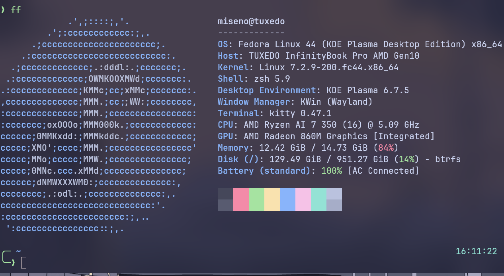

Olen myös aikaisemmin asentanut virtuaalikoneen, jolla voin tehdä testejä kurssin tehtävissä.
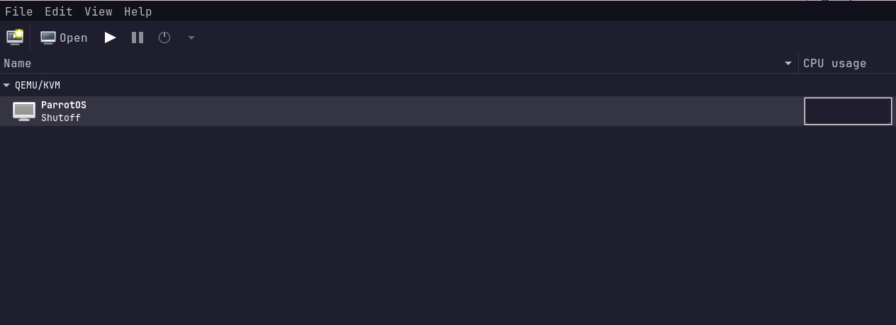 


## b) Sshecrets. Asenna SSH-demoni käsin ja testaa se kirjautumalla SSH:lla. (localhost kelpaa)
Avasin virtuaalikoneeni ja käynnistin siihen ssh demonin komennolla `sudo systemctl enable --now ssh`. Olin jo aikaisemmin asentanut ssh:n avainten generoimista varten.  
Tarkistin vielä, että demoni on käynnissä komennolla `sudo systemctl status ssh`. Kaikki vaikuttaisi olevan kunnossa.
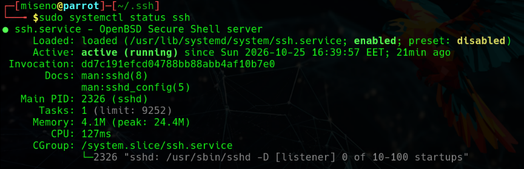

Seuraava steppi oli siirtää oma julkinen avain authorized_keys tiedostoon. Tämä onnistui komennolla `ssh-copy-id <ip-osoite>`.
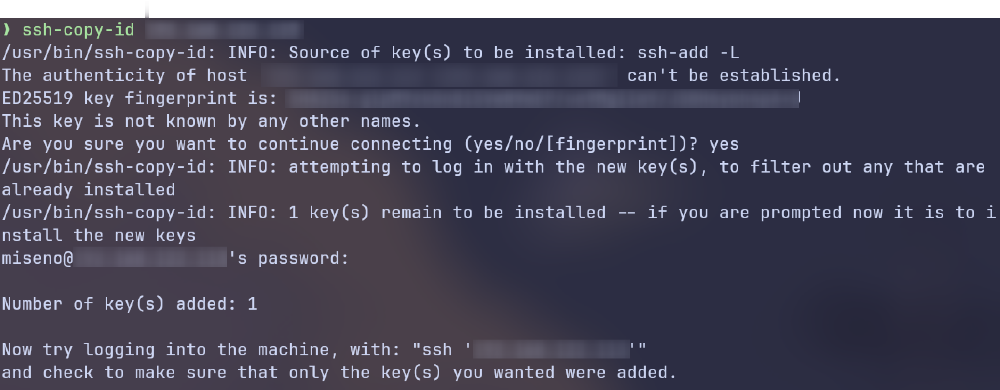

Kävin tarkistamassa ja siellähän se on.
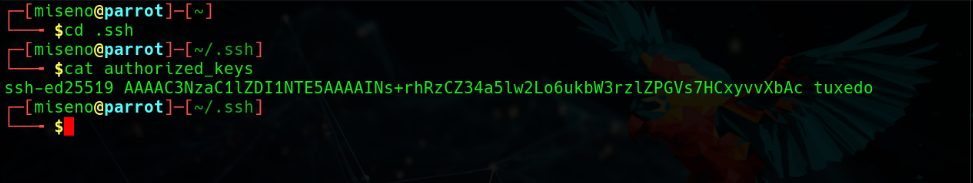

Testaamatta ei ole kuitenkaan valmis, joten avasin vielä etäyhteyden varmuuden vuoksi.
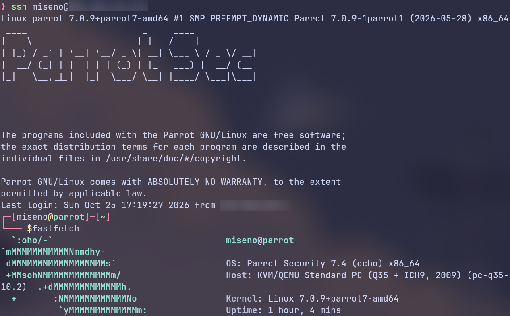

Vuokrasin myös virtuaalipalvelimen ja toistin edellämainitut toimenpiteet. Sain myös siihen yhteyden.
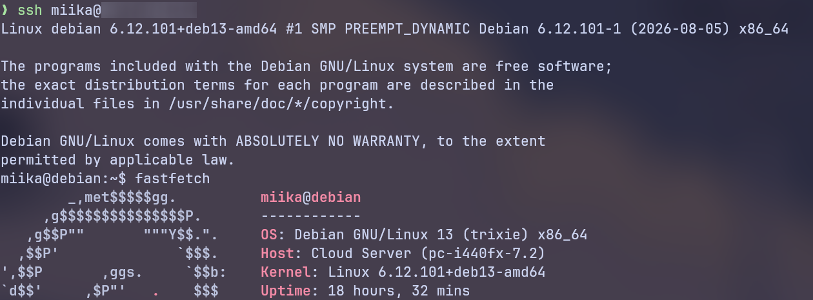

Nyt minulla on siis keksi erillistä konetta mihin voin ajaa komentoja Ansiblella.

## c) Pubkey. Automatisoi ssh-kirjautuminen julkisella avaimella. (localhost kelpaa)
Jaaha, en huomannutkaan että tästä oli erillinen tehtävä. Kyseiset toimenpiteet tehty siis edellisessä osiossa.

## d) Hei Ansible. Tee hei maailma ansiblella ja kokeile sitä SSH:n yli. (localhost kelpaa)
Tässä osiossa seurasin aikaisemmin lukemaani Teron ohjetta Hello Ansible (Karvinen 2026)

Aloitin asentamalla Ansiblen sekä sen riippuvuudet komennolla `sudo dnf isntall ansible`.
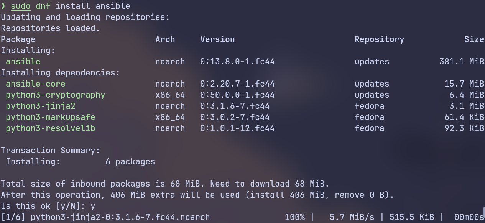

Loin uuden ansible nimisen kansion ja lisäsin sinne tiedoston hosts.ini. Tiedostoon lisäsin sekä virtuaalikoneeni että palvelimeni ip-osoitteet.
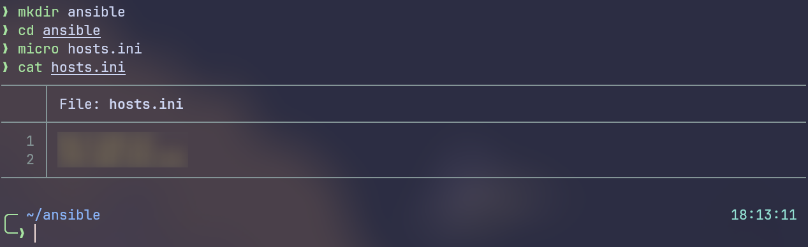

Seuraavaksi oli sitten aika testata etäyhteyden avaamista, joten suoritin saman uptime testin, jonka Tero oli tehnyt omassa ohjeessaan.  
Testi kuitenkin epäonnistui seuraavalla virheilmoituksella:
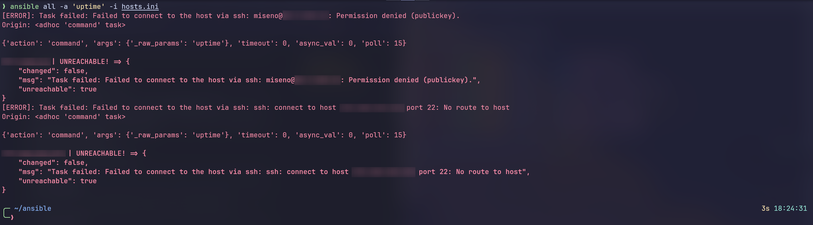

Virheilmoituksessa näkyy selvästi kaksi vikaa:
Virtuaalipalvelimella Permission denied (publickey) -> eli yhteys saatiin, mutta julkinen avain ei hyväksynyt sisäänkirjautumista.  
Virtuaalikoneella No route to host -> eli yhteys ssh demoniin ei onnistunut. Joko portti on kiinni tai demoni ei ole käynnissä. Tämä oli hieman kummallinen ilmoitus, sillä olin juuri tarkistanut että kaikki toimii.

Oli miten oli, oma kompetenssi ei tässä kohtaa enää riittänyt analysoimaan sen pidemmälle, vaan lähetin kyseisen kuvakaapauksen tekoälylle ja kysyin neuvoa (ChatGPT1).
 
Tekoäly osasikin pyytää tarkistamaan, että hostit on merkitty oikein hosts.ini:n.
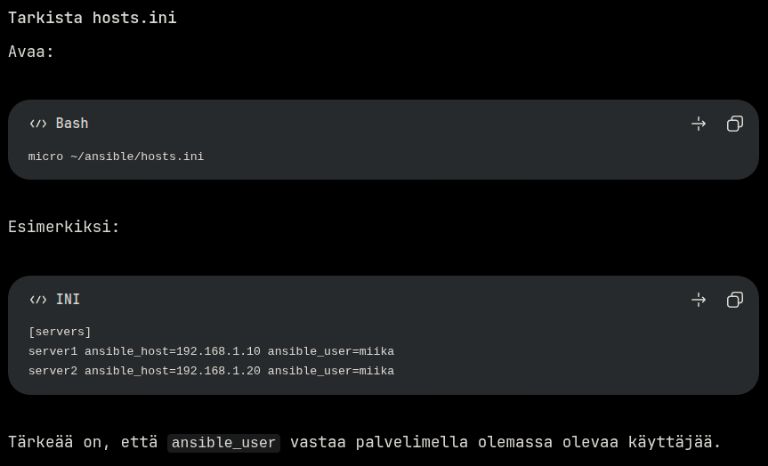

Ei ollut tullut mieleen että kyllähän ssh tietenkin tarvitsee käyttäjän nimen jolla halutaan kirjautua sisään, eikä pelkästään hostin ip-osoitetta.  
Kävin vaihtamassa tiedoston sisällön tekoälyn ehdottamaan muotoon ja tein uuden testin. Kuten olettaa saattoi, nyt yhteys palvelimeen onnistui, mutta virtuaalikone junnasi vielä vastaan.
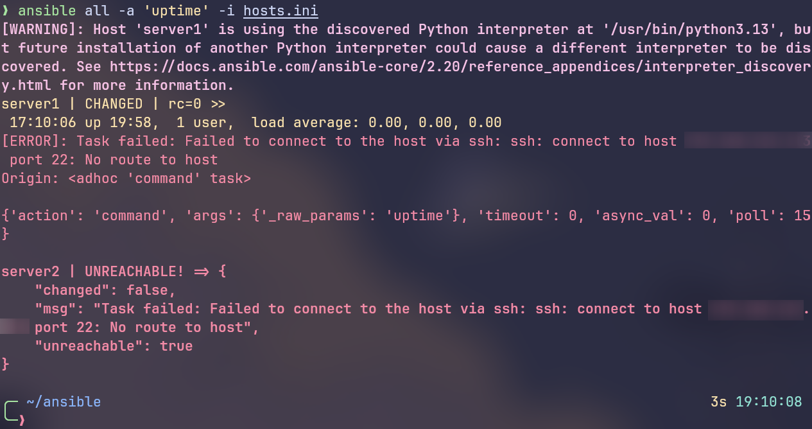

Ja lopulta selvisi myös ongelma virtuaalikoneen kanssa. Se oli vain sammunut itsestään. Kun laitoin sen uudestaan päälle, niin sain samantien yhteyden molempiin.
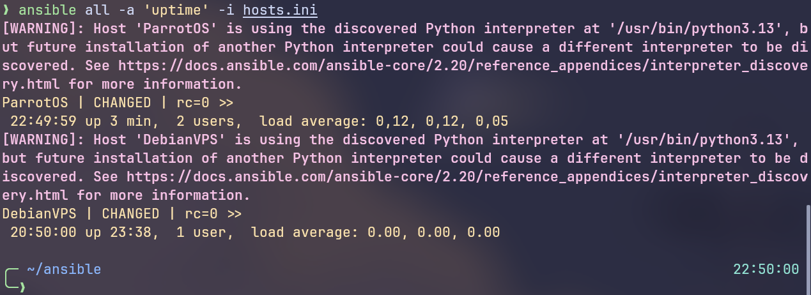

Seuraavaksi määritin hosts.ini -tiedostoon pythonin polun
```
[all:vars]
ansible_python_interpreter=/usr/bin/python3
```
Näin ollen ansible ei enää varoita python version vaihtumisesta koituvista ongelmista ja tuloste on siistimpi.
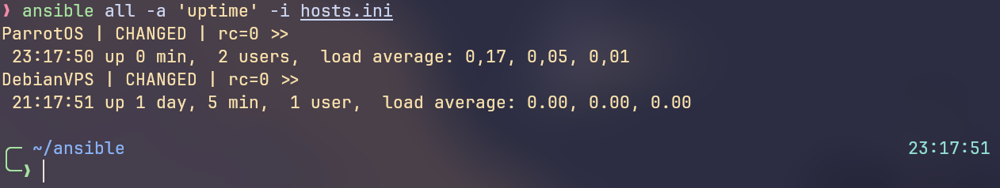

Toinen elämää helpoittava kikka on lisätä ansible.cfg -tiedosto, johon määrittelemme että ansible ja ansible-playbook komennot suoritetaan oletuksena hosts.ini -tiedostossa määriteltyihin koneisiin.
```
[defaults]
inventory = hosts.ini
```
Nyt lyhyempi komento riittää ansiblen ajamiseen.
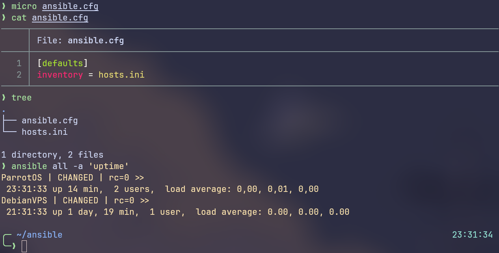

Seuraavaksi tein site.yml -tiedoston. Sinne määritellään mikä kone saa minkäkin configuraation.
Tulos oli odotetunlainen, sillä en ollut vielä tehnyt hello -roolia, joten ansible ei löydä sitä.
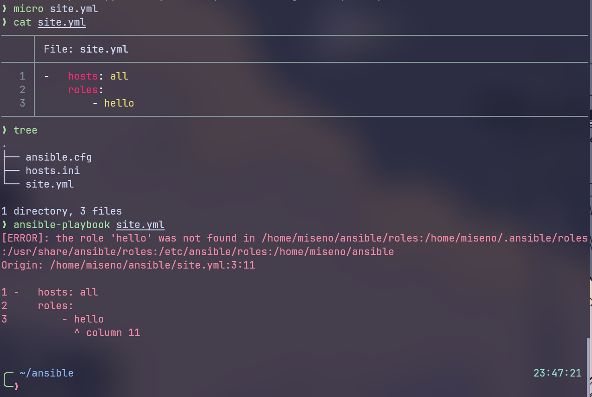

Tein uuden roles/hello/tasks/ -hakemiston, johon tein main.yml tiedoston.
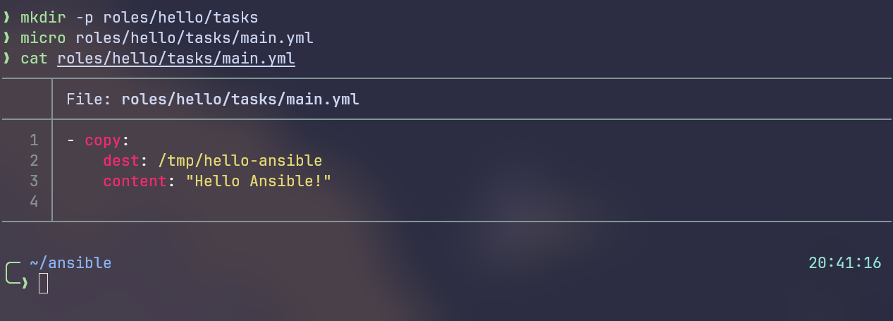

- copy kopioi sisällön kohdekoneelle.
- dest määrittää mihin hakemistoon muutos tehdään.
- content määrittää kopioitavan sisällön.

Nyt kun ajamme uudestaan playbookin, niin huomaamme että muutokset tehtiin. Tarkistin lopuksi vielä ssh:lla, että muutokset tosiaan tehtiin.
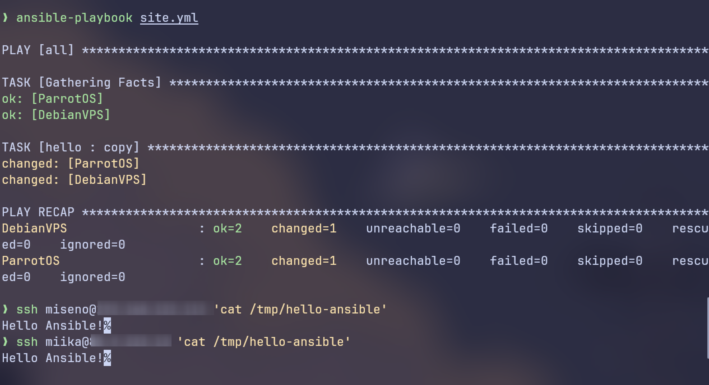

## e) Vapaaehtoinen bonus: kokeile Ansiblella jokin näista asetuksista: paketin asennus, asetustiedosto /etc/ alle, käynnistä jokin demoni, tee uusi käyttäjä. Tarvitset todennäköisesti sudoa, become: true.
Teen vielä keskiviikkona jos ehdin.

## Lähteet
ChatGPT1. Prompt: Tein ansiblella yhteystestin joka epäonnistui. Onko ajatuksia mistä vika voi johtua. Olen tarkistanut että saan avattua normaalin ssh-yhteyden molempiin koneisiin.

Karvinen, T. 2026. Palvelinten Hallinta. Luettavissa: https://terokarvinen.com/palvelinten-hallinta/ Luettu: 23.10.2026

Karvinen, T. 2026. SSH public key - Login without password. Luettavissa https://terokarvinen.com/ssh-public-key-login-without-password/ Luettu: 23.10.2026.

Karvinen, T. 2026. Hello Ansible. Luettavissa: https://terokarvinen.com/hello-ansible/. Luettu: 23.10.2026.
