# Voileipä
Harjoitukset on tehty kotitoimistossa Kaarinassa. Koneena oli Tuxedo InfinityBook Pro AMD Gen10. Käyttöjärjestelmän toimi Fedora Linux 44.  
Harjoituksessa seurataan Teron kotisivujen (Karvinen 2026, 1) tehtävänantoa.

## x) Lue ja tiivistä
### Sudo without password (Karvinen 2026, 2)
- Ansiblella voi ajaa komentoja jotka vaativat sudo-oikeuksia. Sudon voi sallia toimimaan ilman salasanaa.
- Luo uusi käyttäjä (omalle käyttäjälle ei kannata antaa salasanattomia sudo-oikeuksia). Luo uusi käyttäjäryhmä ja lisää uusi käyttäjä siihen.
- Avaa uusi shell ja siirry root -käyttäjäksi `sudo -i` (ainut tapa korjata sudo jos jokin menee pieleen.)
- Tee uusi tiedosto `sudo visudo /etc/sudoers.d/sudoless` ja lisää sinne configuraatio `%sudoless ALL = (ALL) NOPASSWD: ALL`
	- sudoers.d mahdollistaa uusien sääntöjen luomisen ilman että tarvitsee kajote "rinnakkaistiedostoon" sudoers.

Oma havainto: Sudoless -käyttäjä luo ilmiselvän turvallisuusriskin koneelle. Kannattaa varmistaa, että salasana on erittäin vahva, tai vielä parempi, ssh-salasanakirjautuminen palvelimelle on estetty ja pelkästään avainparikirjautuminen on sallittu.

	sudo micro /etc/ssh/sshd_config
	PubkeyAuthentication yes
	PasswordAuthentication no

### xkcd 149: Sandwitch(Munroe 2006)
- Erinomainen jäniskevennys.

### Passwordless sudo with Ansible (Karvinen 2026, 3)
- Edellisessä Teron artikkelissa (Karvinen 2026, 2) kuvailtu sudoless -käyttäjä voidaan luoda myös suoraan ansiblella. Kannattaa kuitenkin pitää mielessä käytäntö, jonka mukaan ainoastaan manuaalisesti opitut asiat automatisoidaan.
- Luo uusi rooli sudoless-määrittelyä varten.
- Luo roolille main.yml, johon tehdään suraavat määritykset:
	- Luo uusi sudoless -ryhmä.
	- Luo uusi käyttäjä, joka lisätään sudo, sudoless ja admin ryhmiin.
	- Lisää julkinen ssh-avain käyttäjän kotihakemistoon.
	- Luo sudoless tiedosto sudoers.d -hakemistoon ja aseta siihen oikeat käyttöoikudet.
- Kun ajat käyttäjällä ansiblea ensimmäisen kerran, tarvitset sudoa, joten määritä site.yml `become: true`.

Oma havainto: Käsittääkseni antero -käyttäjä lisätään turhaan sudo ryhmään. sudoers.d -tiedostoon tehtävä määritys antaa käyttäjälle jo täydet sudo-oikeudet, joten miksi kuulua lisäksi vielä sudo-ryhmään?

### ansible-doc copy
- Copy -moduulia käytetään tiedoston tai hakemistorakenteen kopioimiseen hallintakoneelta kohdekoneelle.
- Tiedostojen käyttöoikeuksia voi hallita mode avain-arvo-parilla.

Optiot:

| Optio | Selitys |
|---|---|
| `content` | Määrittää tiedoston sisällön suoraan. |
| `dest` | Kohdetiedoston tai -hakemiston polku. |
| `group` | Tiedoston omistajaryhmä. |
| `mode` | Tiedoston käyttöoikeudet (`chmod`). |
| `owner` | Tiedoston omistajakäyttäjä. |
| `src` | Kopioitavan lähdetiedoston polku. |

```
- name: Copy file with owner and permissions
  ansible.builtin.copy:
    src: /srv/myfiles/foo.conf
    dest: /etc/foo.conf
    owner: foo
    group: foo
    mode: '0644'
```
- Kopioi tiedosto, määritä sen haltija ja sen oikeudet.

### ansible-doc apt
- Apt -moduulia käytetään paketinhallintaan Debian ja Ubuntu -pohjaisissa distroissa.

Optiot:

| Optio | Selitys |
|---|---|
| `name` | Asennettavan tai poistettavan paketin nimi. |
| `state` | Paketin haluttu tila (viimeisin versio, paketin riippuvuudet jne). |
| `update_cache` | Päivittää apt-pakettiluettelon. |

Esimerkki:
```
- name: Install a list of packages
  ansible.builtin.apt:
    pkg:
    - foo
    - foo-tools
```
- Asenna useampi paketti yhdellä kerralla.

### ansible-doc file
- Määritä tiedostojen ja hakemistojen ominaisuuksia, kuten omistajat, käyttöoikeudet ja symboliset ja kovat linkit.

Optiot:
| Optio | Selitys |
|---|---|
| `path` | Hallittavan tiedoston tai hakemiston polku. |
| `recurse` | Muuttaa hakemiston oikeudet ja omistajuuden rekursiivisesti. |
| `src` | Symbolisen tai kovan linkin kohdepolku. |
| `state` | Kohteen haluttu tila (`file`, `directory`, `touch`, `link`, `hard`, `absent`). |
| `owner` | Tiedoston tai hakemiston omistajakäyttäjä. |
| `group` | Tiedoston tai hakemiston omistajaryhmä. |
| `mode` | Tiedoston tai hakemiston käyttöoikeudet (`chmod`). |

Esimerkki:
```
- name: Create a symbolic link
  ansible.builtin.file:
    src: /file/to/link/to
    dest: /path/to/symlink
    owner: foo
    group: foo
    state: link
```
- Määritä kahden tiedoston välille symbolinen linkki.

### ansible-doc user
- Hallitse käyttäjiä ja niiden ominaisuuksia.

| Optio | Selitys |
|---|---|
| `name` | Hallittavan käyttäjän tunnus. |
| `create_home` | Luo käyttäjälle kotihakemiston. |
| `comment` | Käyttäjän kuvaus tai koko nimi. |
| `groups` | Käyttäjän lisäryhmät. |
| `shell` | Käyttäjän oletuskomentotulkki. |
| `state` | Käyttäjän haluttu tila (`present`, `absent`). |
| `system` | Luo käyttäjän järjestelmätunnuksena. |

Esimerkki:
```
- name: Add the user 'johnd' with a specific uid and a primary group of 'admin'
  ansible.builtin.user:
    name: johnd
    comment: John Doe
    uid: 1040
    group: admin
```
- Lisää uusi käyttäjä, määrittele hänelle käyttäjä-ID sekä mihin ryhmään kuuluu.

### ansible-doc authorized_key
- Lisää tai poista käyttäjän ssh-avaimet.

| Optio | Selitys |
|---|---|
| `user` | Käyttäjä, jonka SSH-avaimia hallitaan. |
| `key` | Lisättävä julkinen SSH-avain. |

Esimerkki:
```
- name: Set authorized keys taken from path on controller node
  ansible.posix.authorized_key:
    user: charlie
    state: present
    key: file:///home/charlie/.ssh/id_rsa.pub
```
- Lisää julkinen ssh-avain. Avain haetaan ohjauskoneen käyttäjän kotihakemistosta.

## a)  Sudoless. Tee ansiblea varten tunnus, jolla voi käyttää sudoa ilman salasanaa. Sekä ssh-kirjautuminen että sudon käyttö tulee olla ansbilea varten automatisoitu.
Seurasin Teron (Karvinen 2026, 1) dokumentaatiota ja loin uuden käyttäjän `sudo adduser ansimi`. Loin uuden käyttäjäryhmän `sudo groupadd sudoless`, ja lopulta lisäsin uuden käyttäjän kyseiseen ryhmään `sudo adduser ansimi sudoless`.

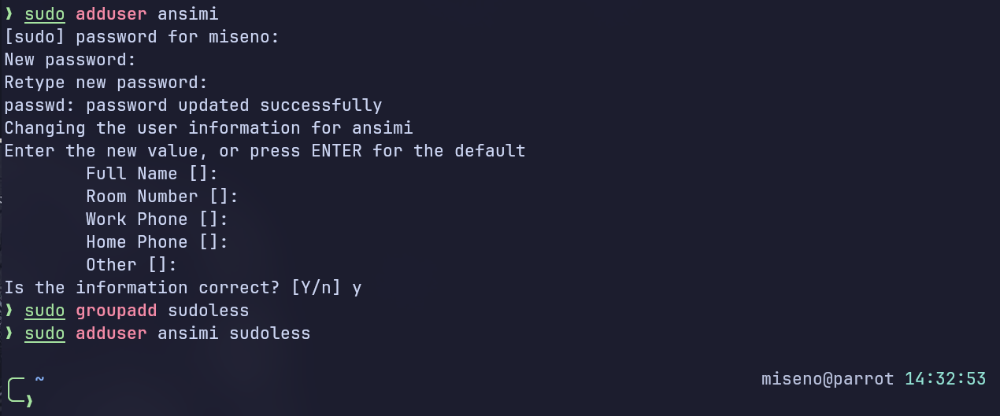

Tässä kohtaa pelasin varman päälle ja avasin uuden shellin, jolla kirjauduin uudestaan sisään ja vaihdoin root-käyttäjäksi. Jos jokin menisi pieleen, voisin tätä kautta lähteä selvittelemään aiheuttamiani sotkuja.

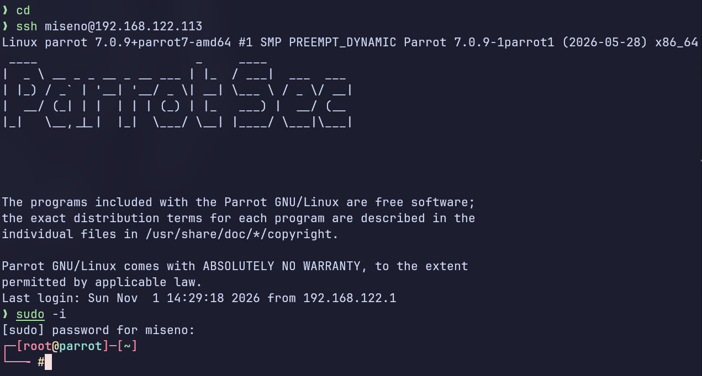

Loin uuden tiedoston sudoers.d -kansioon, ja lisäsin sinne tekstin `%sudoless ALL = (ALL) NOPASSWD: ALL`
- `%sudoless` ryhmä johon sääntö halutaan kohdentaa.
- `ALL` sääntö koskee kaikkia isäntäkoneita.
- (ALL) Sääntö koskee kaikkia ryhmän jäseniä.
- `NOPASSWD: ALL` Salasanaa ei vaadita ja sääntö koskee kaikkia komentoja.

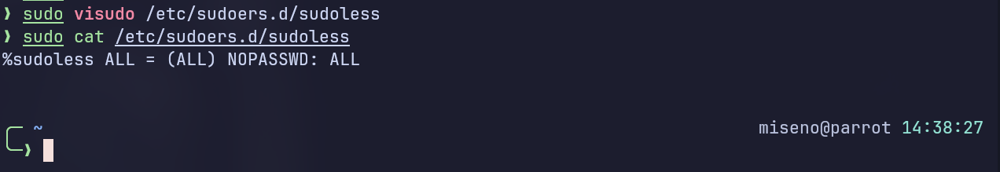

Lopuksi tein testin kirjautumalla sisään ja ajamalla sudo -komennon. Minulta ei kysytty salasanaa, joten muutokset tehtiin onnistuneesti.

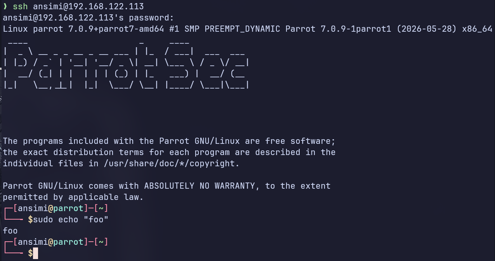

## b) Antero. Tee salasanaton, automaattisesti ssh:lla kirjautuva tunnus Ansiblella.
Aloitin luomalla uuden hakemistopolun sudoless -toiminnolle `mkdir -p roles/ansimi/tasks/`. Tänne loin uuden main.yml -tiedoston.  
Tiedostoon lisäsin Teron dokumentaatiosta löytyvät tekstit pienten muokkausten kera.

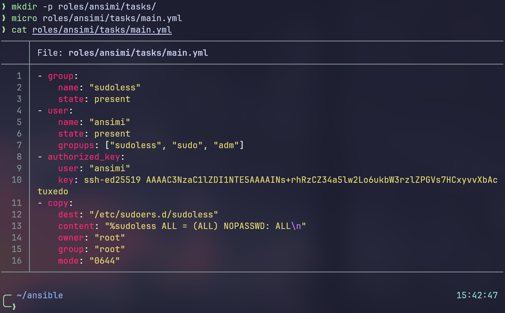

- main.yml sisältö selitettynä aiakisemmassa tehtävässä (x - Passwordless sudo with Ansible)

Edellisessä tehtävässä luomani salasanattoman käyttäjän tein virtuaalikoneelleni (VM). Minulla on myös virtuaalipallvelin (VPS). Tulen seuraavassa vaiheessa ajamaan ansible -roolin molemmille koneille. Tulostuksessa pitäisi näkyä, että VPS:ssä on tapahtunut enemmän muutoksia, sillä VM:lle lisätään ainoastaan julkinen SSH-avain käyttäjän kotihakemistoon.

Kävin vielä ennen ajoa muokkaamassa site.yml -tiedostoa. Lisäsin `become: true`, joka suorittaa tehtävän korotetuilla oikeuksilla.

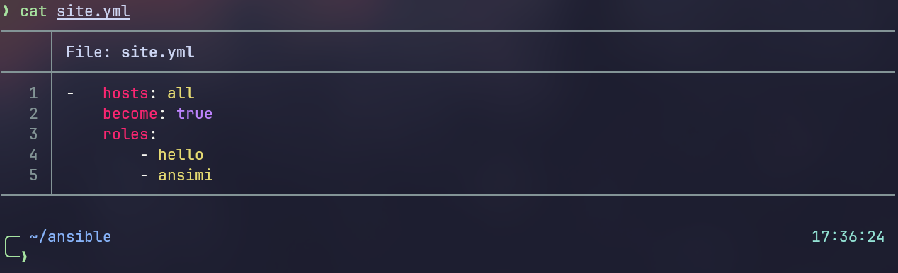

Sitten ajoa!  
Ensimmäinen error -viesti kertoo selkeästi vian syyn. Group -määritykset olivat menneet hienosti läpi, mutta user -moduulissa on käytetty jotain siihen kuulumatonta parametria.

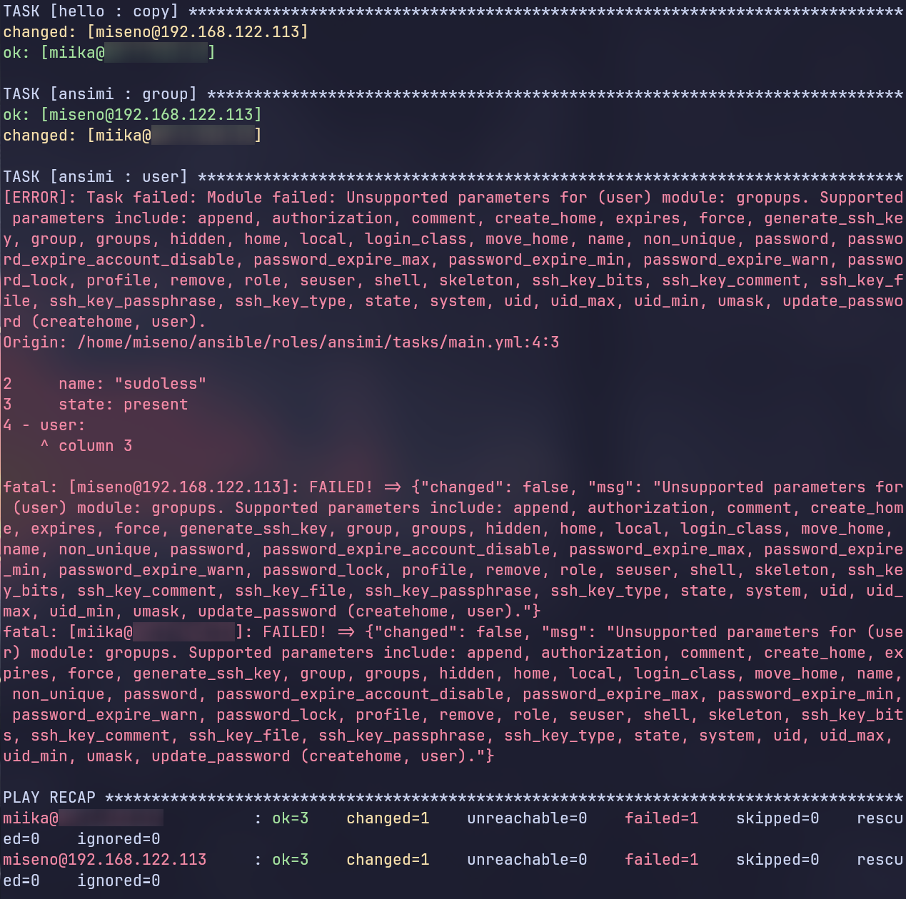

Tarkasteltaessa vikakin löytyi nopeasti. Groups -sanaan oli sattunut typo.

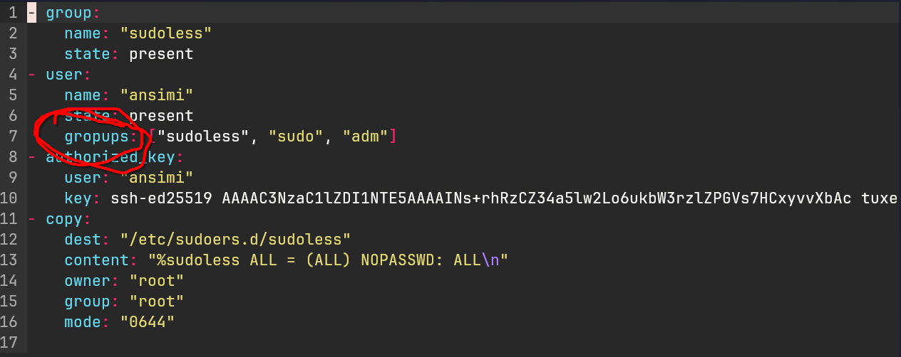

Korjasin kirjoitusvirheen ja ajoin playbookin uudestaan. Tällä kertaa homma meni läpi nätisti.

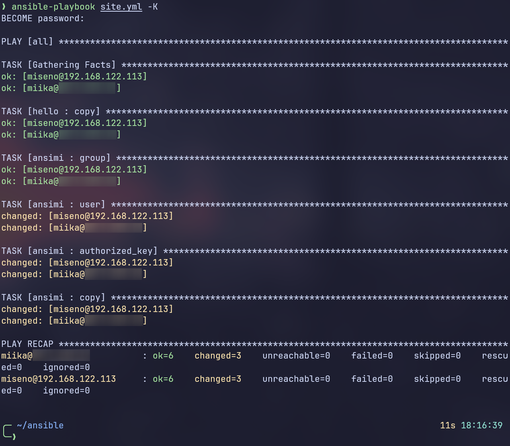

Itseäni jäi vielä mietityttämään, että miksi virtuaalikoneellani tapahtui muutoksia, vaikka samat asiat oltiin jo määritelty manuaalisesti. Tämänhetkinen hypoteesi on, että user -moduulissa määriteltiin ryhmiksi myös sudo ja admin, joita ei edellisessä harjoituksessa tehty. copy -moduulissa sen sijaan määriteltiin tiedoston käyttöoikeudet, jotka saattavat poiketa edellisessä tehtävässä luodun tiedoston default-käyttöoikeuksista.

Kävin vielä manuaalisesti tarkistamassa Parrotin `/etc/passwd`, `/etc/group` sekä `etc/sudoers.d/sudoless`, ettei sinne ollut tullut mitään huolimattomuusvirheitä.

Seuraavaksi muokkasin hosts.ini -tiedostoa. Lisäsin sinne uuden käyttäjän ja muutin kohdekoneiden listan sellaiseksi, että julikista ip-osoitetta ei tarvitse blurrata joka kerta kun ajan playbookin.

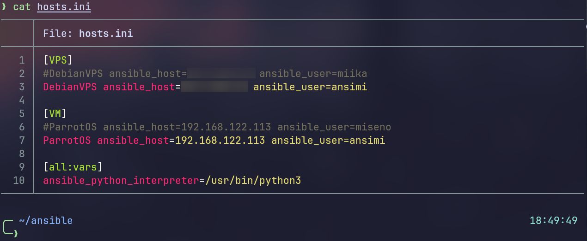

Nyt voimme ajaa ansiblen täysin ilman become -salasanaa, kas näin.

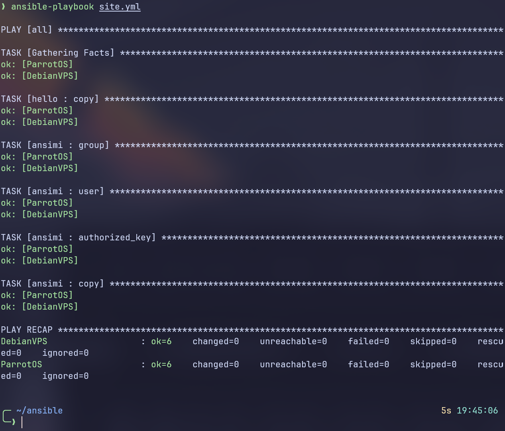

## c) Package. Asenna kaksi pakettia ansiblella.
Tein hakemiston `/roles/packages/tasks` ja sinne main.yml.  
Mainiin laitoin testimielessä asennettavaksi kaksi pientä ohjelmaa, curl ja tree.  
site.yml lisäsin kyseisen roolin.

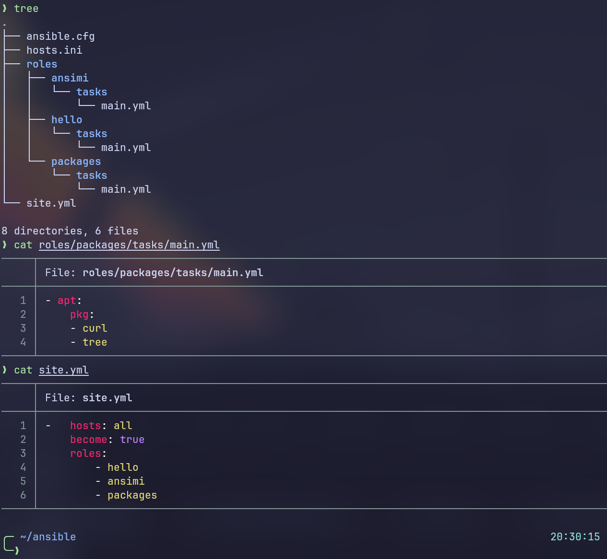

Sitten ajoin taas playbookin.

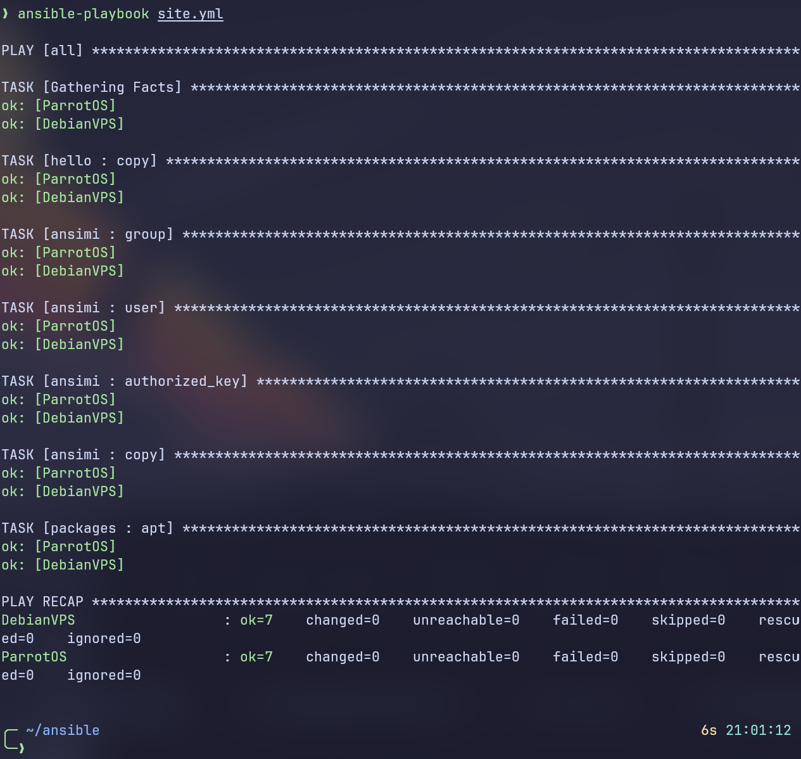

apt -rooli luettiin, mutta mikään ei muuttunut. Johtunee siitä, että molemmat ohjelmat ovat jo asennettuina molemmille koneille.  
Koitetaan seuraavaksi asentaa pari ohjelmaa jotka eivät ainakaan ole asennettuina.

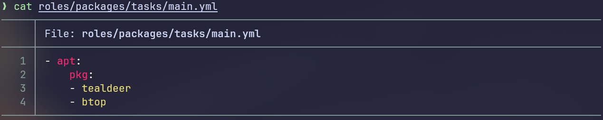

- tealdeer (ajetaan tldr) on kätevä ohjelma, joka näyttää kompaktin listauksen yleisimmistä komennoista ja tavoista käyttää tiettyä ohjelmaa. Tämä on erinomainen tapa virkistää muistia jos on unohtanut peruskomennon ja ei jaksa plärätä man-sivuja. 
- btop on järjestelmänvalvontaohjelma, joka listaa käynnissä olevat prosessit ja näyttää prosessorin, muistin ja verkon tilanteen.

Nyt kun ajoin ohjelman, niin koneissa tapahtui muutos.

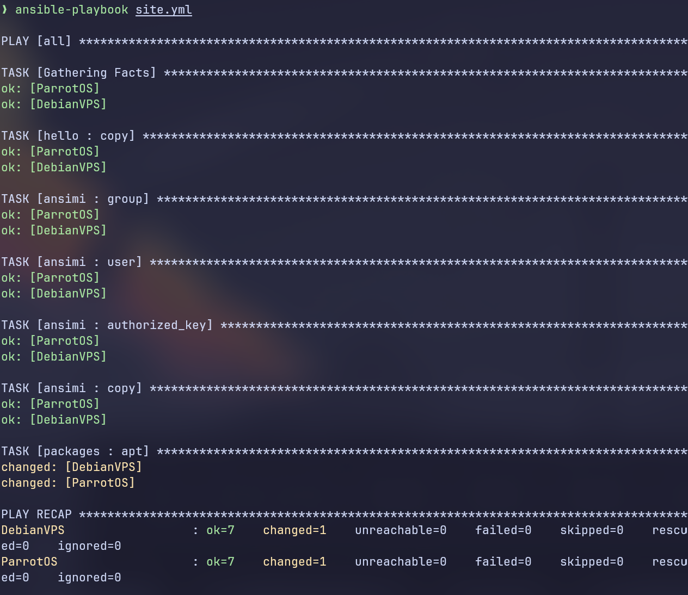

Käydään tarkistamassa että paketit asentuivat.

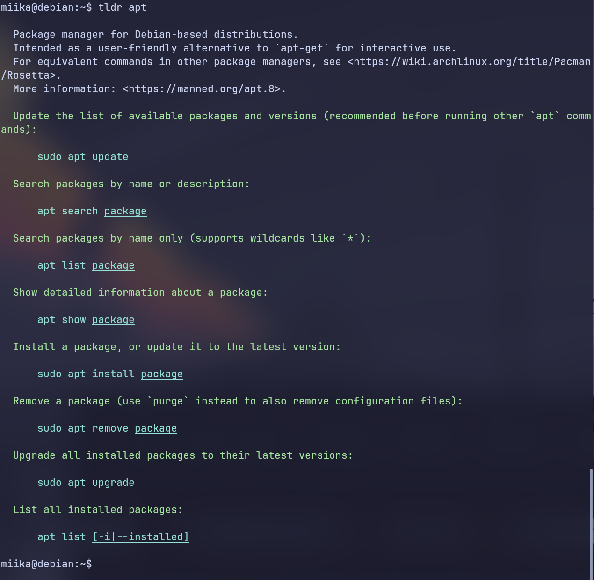
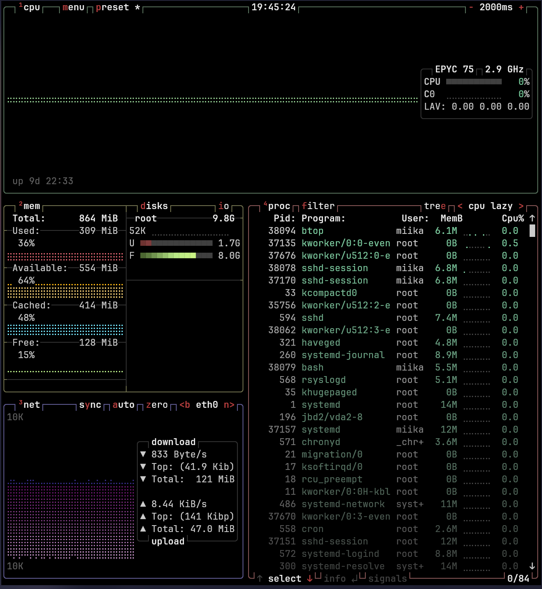

## d) File. Kirjoita orjalle useamman rivin mittainen tiedosto Ansiblella. Määrittele sen omistaja, omistava ryhmä ja oikeudet. Käytä oikeuksille oktaalinumeroa, esim. "0600". Kerro, mitä oikeudet ovat symbolisessa muodossa, esim. "-rwxr--r--". Selitä, mitä kukin käyttäjä saa tehdä tuolle tiedostolle.
Aloitin taas tekemällä hakemiston ja tiedoston.

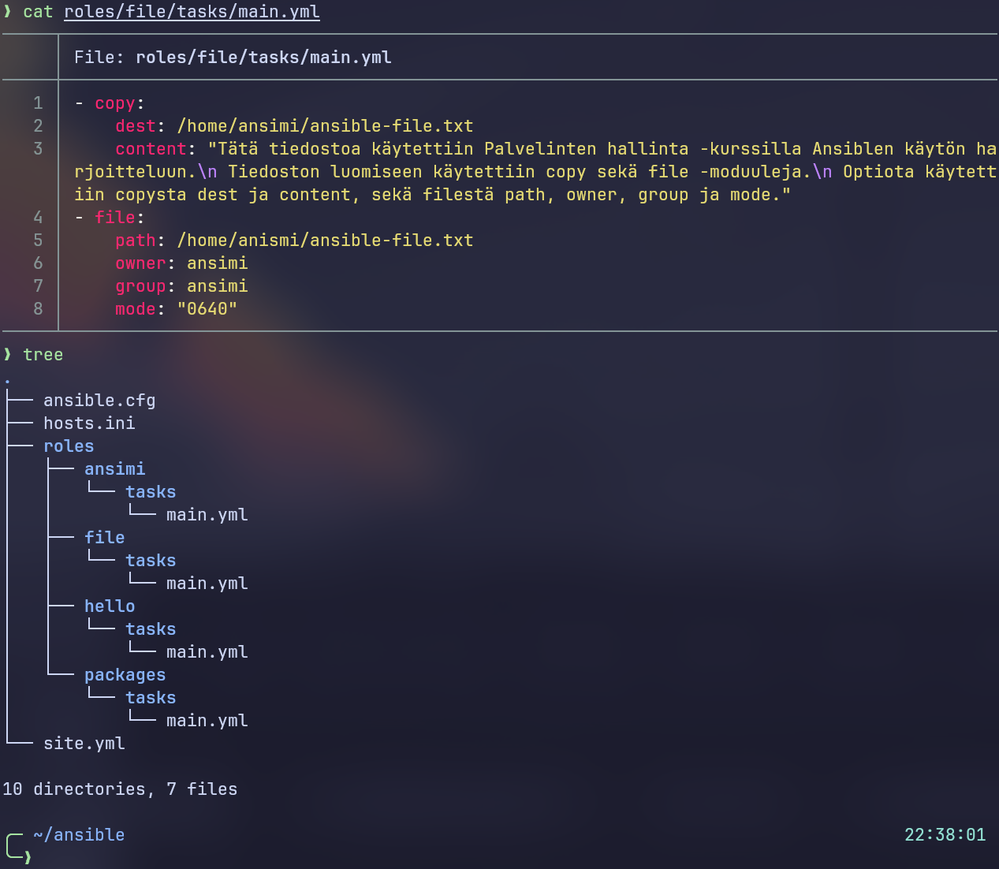

- Tässä luodaan ensin tiedosto dest:ssä kuvattuun polkuun.
- Tiedoston sisältö määritellään content- optiolla.
- File -moduulissa kuvataan polku optiolla path samaan tiedostoon.
- Määritellään omistajaksi ansimi ja ryhmäksi anismi -ryhmä.
- Oikeudet ovat -rw-r-----. Eli omistaja voi lukea ja muokata tiedostoa. Ryhmän muut jäsenet voivat lukea tiedoston. Kaikilla muilla ei ole mitään asiaa tiedostoon.

Tämä aiheutti errorin. Ensimmäinen steppi, eli tiedoston luominen onnistui, mutta kuten errorista näkee, kun tiedoston oikeuksia yritettiin muokata, sitä ei löytynytkään. Tämä johtui taas kirjoitusvirheestä.

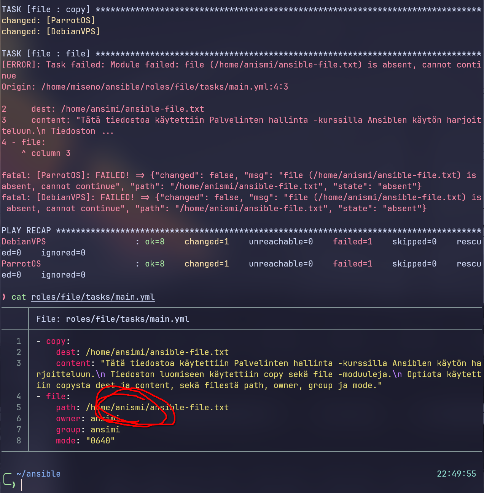

Kun korjasin sen ja ajoin playbookin uudestaan, niin homma meni onnistuneesti läpi.

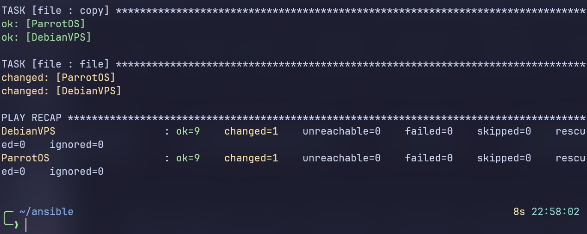

Lopulta kävin vielä tarkistamassa että tiedosto löytyi oikeasta paikasta, ja että omistajat ja oikeudet olivat oikein.

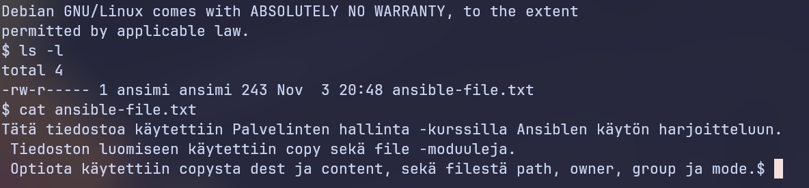
## e) Jotain muuta. Näytä esimerkki ansiblen käskystä, jota ei ole vielä käsitelty kurssilla tai kotitehtävissä. Voit ottaa jonkun muun modulin kuin apt, file, copy, user tai authorized_key. Tai voit käyttää ominaisuutta, jota ei vielä ole demonstroitu. Jos tiivistystehtävässä x on mainittu ominaisuuksia, joita ei tunneilla tai läksyissä kokeiltu, nekin kelpaavat.
Teen myöhemmin jos ehdin.

## Lähteet
ansible-doc copy. Ansiblen sisäänrakennettu dokumentaatio copy -moduulista.

ansible-doc apt. Ansiblen sisäänrakennettu dokumentaatio apt -moduulista.

ansible-doc file. Ansiblen sisäänrakennettu dokumentaatio file -moduulista.

ansible-doc user. Ansiblen sisäänrakennettu dokumentaatio user -moduulista.

ansible-doc authorized_key. Ansiblen sisäänrakennettu dokumentaatio authorized_key -moduulista.

Karvinen, T 1. 2026. Palvelinten Hallinta. Luettavissa: https://terokarvinen.com/palvelinten-hallinta/. Luettu: 23.10.2026

Karvinen, T 2. 2026. Sudo without password. Luettavissa: https://terokarvinen.com/passwordless-sudo/. Luettu 31.10.2026

Karvinen, T 3. 2026. Passwordless Sudo with Ansible: https://terokarvinen.com/passwordless-sudo-with-ansible/. Luettu: 31.10.2026.

Munroe, R. 2006. Sandwich. Luettavissa: https://xkcd.com/149/. Luettu: 31.10.2026.
