# Demoni
Harjoitukset on tehty kotitoimistossa Kaarinassa. Koneena oli Tuxedo InfinityBook Pro AMD Gen10. Käyttöjärjestelmän toimi Parrot Security 7.4 (echo) x86_64.  
Harjoituksessa seurataan Teron kotisivujen (Karvinen 2026, 1) tehtävänantoa.

## x) Lue ja tiivistä
### Apache installed with Ansible – quick notes (Karvinen 2026, 2)
- Apache2-verkkopalvelimen asennus ja konfigurointi voidaan automatisoida Ansiblella.
- Palvelinten konfiguroinnissa käytetään package-file-service-mallia.
- Suurin osa demoneista ovat perus käyttöönotoltaan melko samanlaisia, joten niin on myöskin sen automatisointi automatisointi.
- Apache2-roolin hakemistorakenne koostuu tasks, files ja handlers -hakemistoista.
- notify ilmoittaa handlerille, että konfiguraatiotiedostoon on tehty muutoksia ja Apache pitää käynnistää uudelleen.

Oma havainto: Verkkosivuston tiedostot voidaan sijoittaa tavallisen käyttäjän kotihakemistoon, jolloin sivustoa voidaan muokata ilman sudo-oikeuksia.

### Handlers: running operations on change (Ansible Community Documentation)
- Handlerit ovat Ansible-tehtäviä, jotka suoritetaan vain silloin, kun jokin toinen tehtävä ilmoittaa tapahtuneesta muutoksesta.
- Handlerin suoritus käynnistetään notify-avainsanalla.
- Yksi tehtävä voi ilmoittaa muutoksesta useammalle handlerille.
- Handlerit suoritetaan siinä järjestyksessä, jossa ne on määritelty handlers-osiossa, eikä notify-listan järjestyksessä.
- Jos useampi tehtävä kutsuu samaa handleria, se suoritetaan silti vain kerran kyseisessä suorituskierroksessa.
Oma havainto: Handlerit tukevat Ansiblen idempotenttia toimintaa, sillä palveluita ei tarvitse käynnistää uudelleen, jos konfiguraatio ei ole muuttunut. Mitä tapahtuu, jos tehtävä ilmoittaa handlerille muutoksesta, mutta playbookin myöhempi tehtävä epäonnistuu ennen handlerin suorittamista?

### ansible-doc service
- Service-moduuli tukee useita palvelunhallintajärjestelmiä, kuten systemd, SysV ja OpenRC.
- service tunnistaa automaattisesti, mitä palvelunhallintajärjestelmää kohdekone käyttää, ja käyttää sille sopivaa moduulia.
- Kaikki palvelunhallintajärjestelmät eivät tue samoja toimintoja.
- Windows-koneiden palveluiden hallintaan käytetään erillistä ansible.windows.win_service-moduulia.

Optiot:

| Optio | Selitys |
|---|---|
| `enabled` | Määrittää, käynnistyykö palvelu automaattisesti koneen käynnistyessä (true/false). |
| `name` | Hallittavan palvelun nimi. |
| `state` | Palvelun haluttu tila (started, stopped, restarted, reloaded). |

Esimerkki:
```	
- name: Start Apache and enable on boot
  ansible.builtin.service:
    name: apache2

    state: started
    enabled: true
```
- Käynnistää Apache2-palvelun, jos se ei ole jo käynnissä, ja määrittää palvelun käynnistymään automaattisesti koneen käynnistyessä.

## a) Apassi. Asenna Apache 2 käsin. Weppisivun tulee näkyä palvelimen etusivulla. Sivun tulee olla tavallisen käyttäjän muokattavissa, ilman root- tai sudo-oikeuksia.
Yritin tehdä harjoituksen suurimmaksi osaksi ulkomuistista, ja onnistuinkin, vaikkakin hieman takerrellen.  
Koodiblokkeihin kirjaan komennot oikeassa järjestyksessä, joilla saat halutun lopputuloksen. Kuvakaappauksista saat seurata sekoiluani.

Kirjauduin ssh:lla virtuaalikoneeseeni ja asensin apachen. Se olikin näköjään jo asennettuna.

	sudo apt-get update
	sudo apt-get install apache2

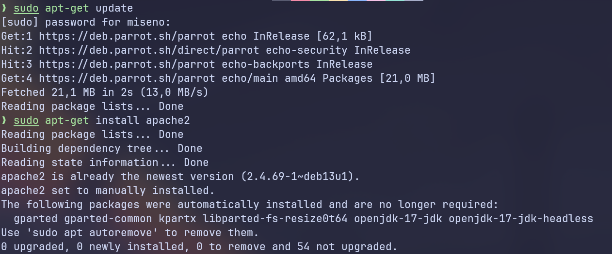
	 
Tarkistin demonin tilan ja käynnistin sen. Uudelleenkäynnistyksen jälkeen sain tilan active (running).

	sudo systemctl status apache2
	sudo systemctl enable apache2
	sudo systemctl restart apache2

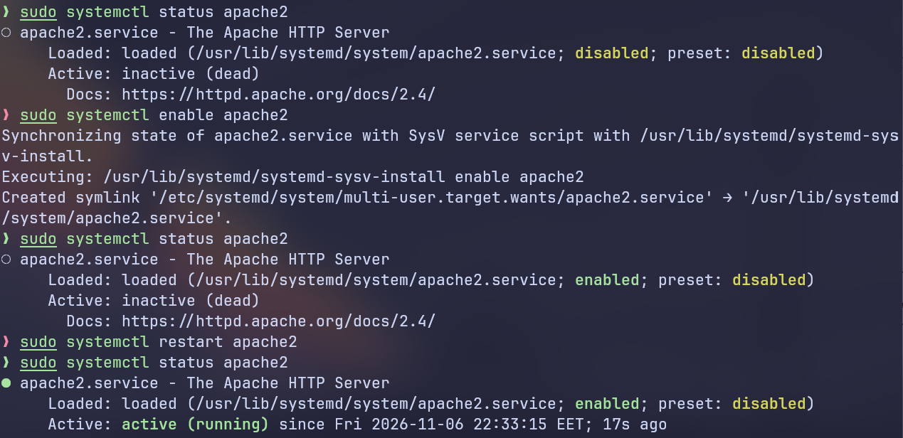

Tässä kohtaa tarkistin, että apachen oletus-sivu näkyy.

	curl localhost

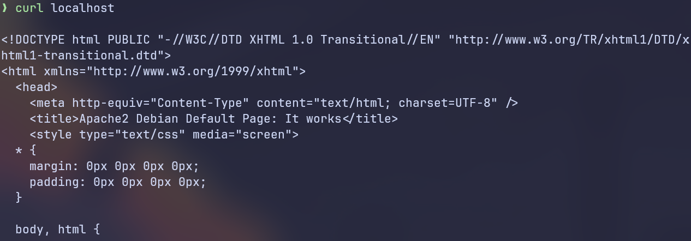
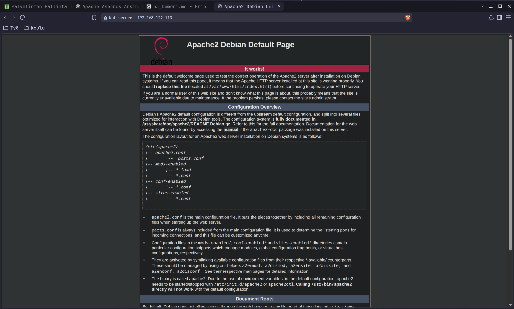

Lähdin etsimään configuraatiotiedostoa. Muistin, että se löytyy /etc/apache2 -hakemistosta. sites-available ja sites-enabled kuulostivat tutuilta joten tutkin niiden sisältöä.

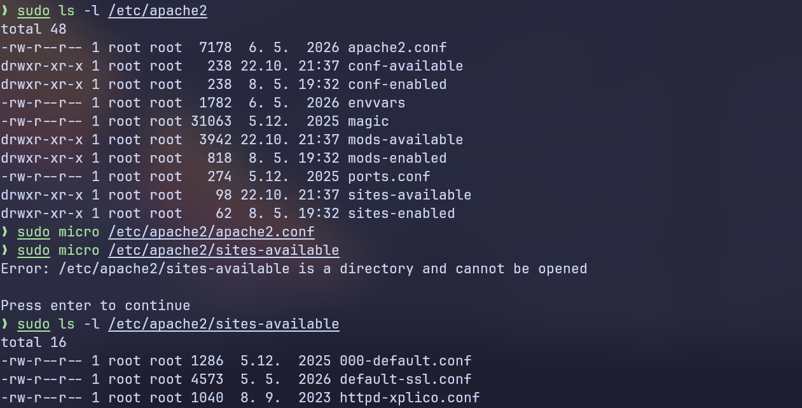

000-default.conf sisältä löytyi etsimäni hakemistopolku, joka osoitti apachen oletus-sivulle.

	sudo micro /etc/apache2/sites-available 

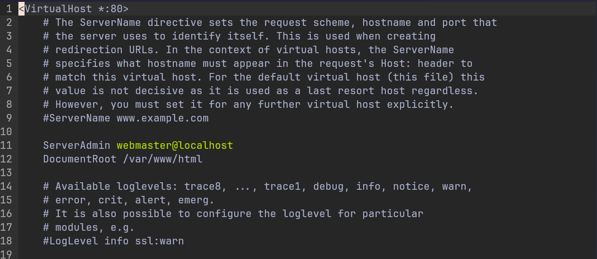

Vaihdoin tähän polun omaan kotihakemistoon, mutta en tässä kohtaa tehnyt muita muutoksia.

	/home/miseno/www/

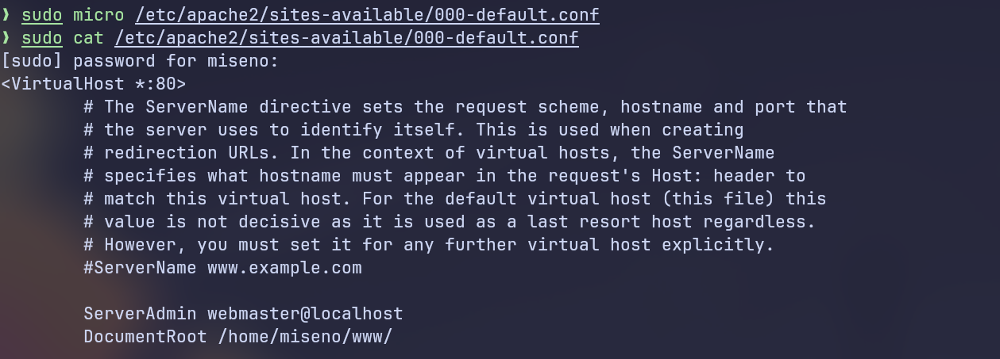

Eli nyt oletus-sivun ei pitäisi enää näkyä. Tein uuden curlin, mutta sivu näkyy edelleen. Tajusin, että demonia pitää potkaista jotta muutokset astuvat voimaan.

	sudo systemctl restart apache2
	curl localhost

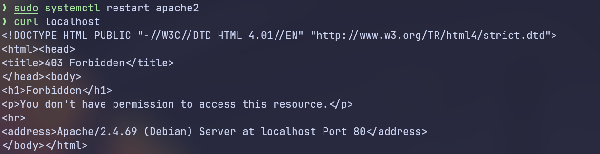

HTML-response 403 Forbidden on odotettu tulos, koska en ole vielä muuttanut käyttöoikeuksia kotihakemistooni.

Tein uuden hakemiston www.

	mkdir www
	
`tldr chmod` mukaan -R parametria käyttämällä pitäisi pystyä antamaan rekursiivisesti oikeuksia tiedostoille ja hakemistoille, mutta tämä ei jostain syystä toiminut.

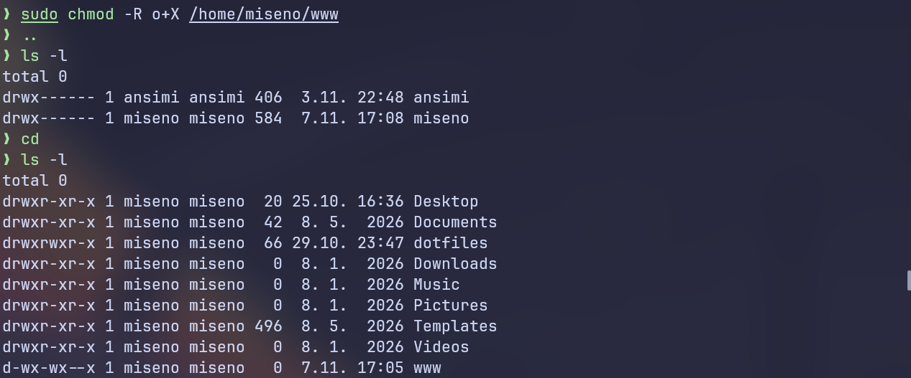

Muutin hakemistojen oikeudet tuttun tapaan ja tarkistin että kaikki on kunnossa.

	sudo chmod o+x /home/miseno/www
	sudo chmod o+x /home/miseno/
	sudo chmod o+x /home/

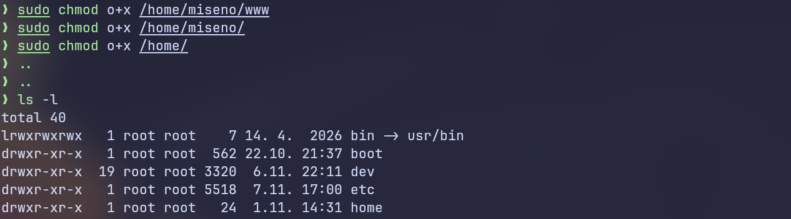
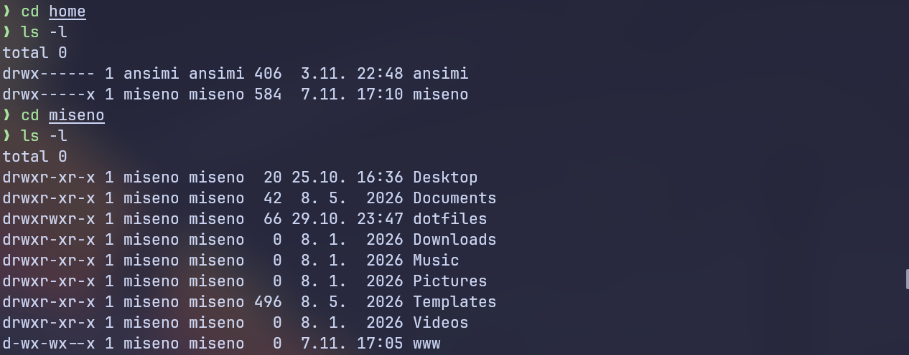

Tein index.html -tiedoston www -kansioon. chmodin -R parametri oli todennäköisesti poistanut www -kansion kaikkien lukuoikeuden, joten annoin lukuoikeuden takaisin käyttäjälle.

	sudo chmod u+r www

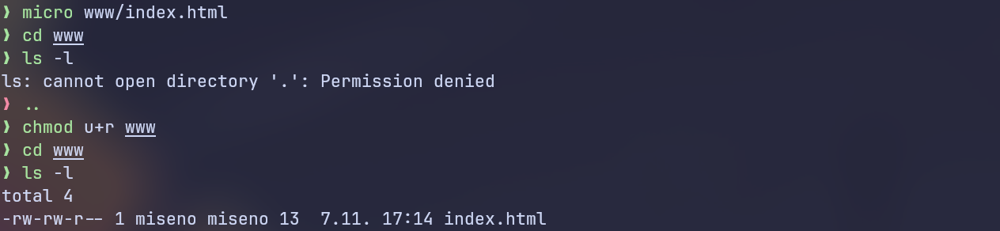

Nyt kaiken järjen mukaan curlin pitäisi näyttää luomani html-sisältö.

Väärin. Edelleen ei ole oikeutta. Koitin varmuuden vuoksi potkaista demonia uudestaan, mutta ei vaikutusta.

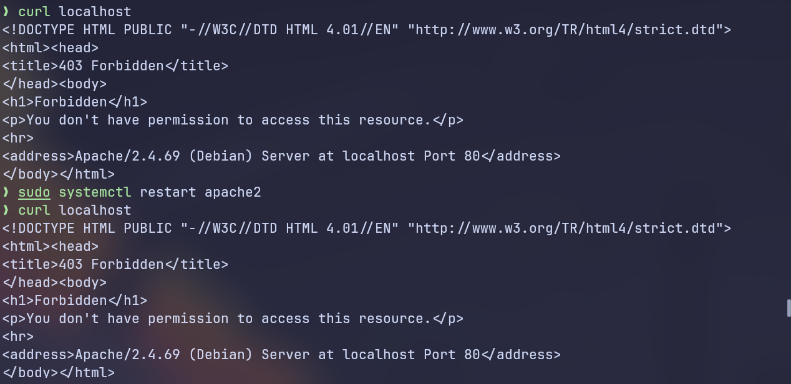

Muistin, että en ole aukaissut porttia 80 palomuuriin. Tämä ei kuitenkaan selitä vikailmoitusta, sillä jos apache ei pääsisi palomuurista läpi, HTTP-response olisi ollut Unreachable.  
Päätin kuitenkin varmuuden vuoksi laittaa ufw:n kuntoon. `tldr ufw` muistutti ufw:n syntaksista ja sain palomuurin käyntiin.

	sudo apt-get install ufw
	sudo ufw allow 22/tcp
	sudo ufw allow 80/tcp
	sudo ufw enable

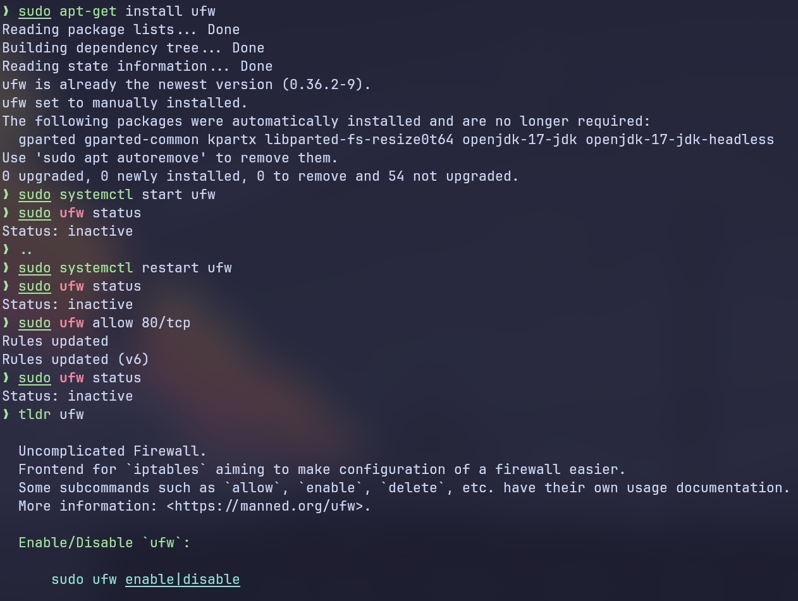
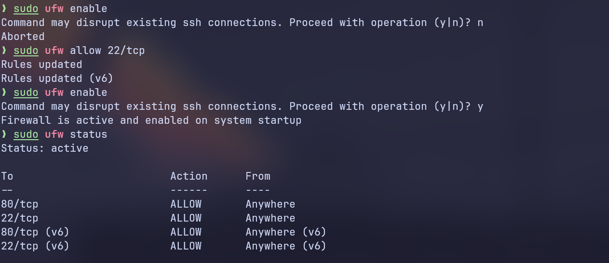

Tein jälleen uuden curlin, mutta tulos oli edelleen sama.

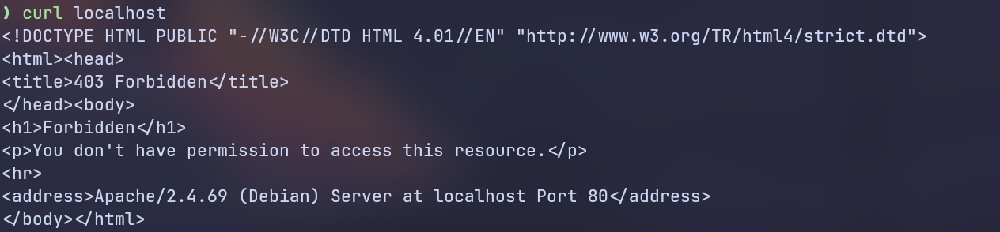

Kävin tarkistamassa olisiko `etc/apache2/sites-enabled` -hakemistossa ollut jotain mitä piti vielä muuttaa, mutta siellä oli vaan symboliset linkit `sites-available` -hakemiston tiedostoihin.

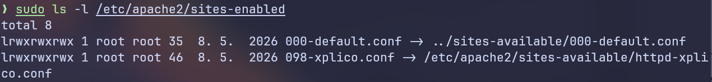

000-default.conf -tiedostosta löytyi apachen errorlogin polku, josta kävin kurkkaamassa jos sieltä olisi saanut lisätietoa.


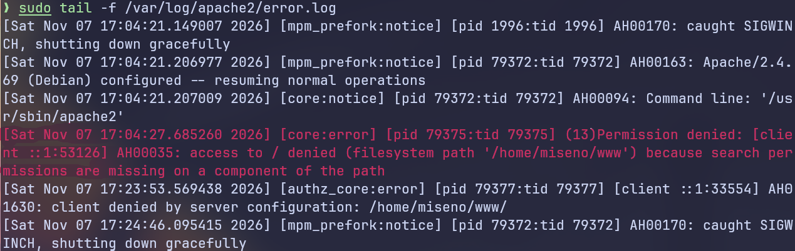

Error loki ei kuitenkaan kertonut mitään mitä emme jo tienneet.

Tässä kohtaa sisäiselle ongelmanratkaisijalle alkoi riittää, joten kävin lunttaamassa omasta linux-kurssin raportistani (Nordblad 2025). Eihän sitä muutenkaan joka päivä pääse viittaamaan omaan työhönsä.

Raportistani löytyikin nopeasti yksi kohta, minkä olin aikaisemmin lisännyt 000-default.conf -tiedostoon, mutta oli nyt unohtunut. Siivosin myös turhia kommentteja pois tiedostosta.

	sudo micro /etc/apache2/sites-enabled/000-default.conf
	
	<Directory /home/miseno/www/>
		Require all granted
	</Directory>

	sudo systemctl reload apache2
	curl localhost


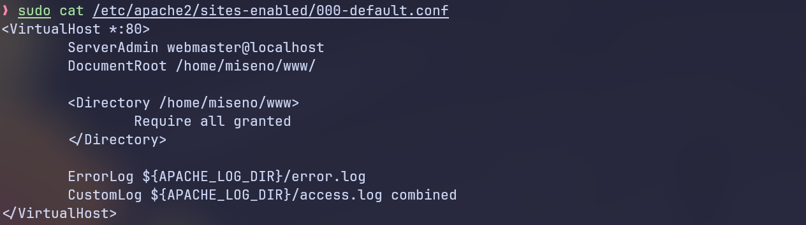

## b) Moottorix. Asenna Nginx käsin. Weppisivun tulee näkyä palvelimen etusivulla. Sivun tulee olla tavallisen käyttäjän muokattavissa, ilman root- tai sudo-oikeuksia. (Muista sammuttaa Apache ensin.)


## c) Automoottorix. Automatisoi Nginx asennus Ansiblella. Ylläpitäjän osuus Ansiblella riittää, itse HTML-weppisivut voi tehdä käsin.


## Lähteet
Karvinen, T 1. 2026. Palvelinten Hallinta. Luettavissa: https://terokarvinen.com/palvelinten-hallinta/. Luettu: 6.11.2026

Nordblad, M. 7.9.2025. Hello Web Server. Luettavissa: https://github.com/m1seno/linux-palvelimet/blob/main/h3%20Hello%20Web%20Server.md. Luettu: 7.11.2026

