# Pizza Fantasia
Harjoitukset on tehty kotitoimistossa Kaarinassa. Koneena oli Tuxedo InfinityBook Pro AMD Gen10. Käyttöjärjestelmän toimi Parrot Security 7.4 (echo) x86_64.  
Harjoituksessa seurataan Teron kotisivujen (Karvinen 2026) tehtävänantoa.
## x) Lue ja tiivistä.
### 4.12.1 Size and Complexity of Some DSLs (Karvinen 2024, 112)
- Kappaleessa vertaillaan Saltin ja Puppetin DSL-kieliä (Domain Specific Language).
##### Salt
- Saltin DSL-kielessä on 510 tilafunktiota ja sen dokumentaatio on yli 20 000 riviä pitkä.
- Jinja2 malleja käytetään generoimaan YAML-koodia joka käännetään Python-koodiksi kun se ajetaan.
##### Puppet
- Puppet sisältää oletuksena 113 funktiota. Sen rakenne ei vastaa tyypillisiä ohjelmiontikieliä kuten C, Go tai Python.
- Tyypillisessä ohjelmointikielessä käytetään funktioita, joilla määritellään useasti toistettavia toimintoja. Puppetissa sen sijaan käytetään omanlaisia virtuaalisia resursseja.

Oma havainto:
Vaikuttaa siltä, että konfiguraationhallintatyökalujen toimintaperiaate poikkeaa perustavanlaatuisesti toisistaan. Käyttäjän kannattaa ehkä siis valita yksi ohjelma mitä käyttää, jottei opittavia funktioita ja sääntöjä tule liikaa.

### 4.12.2 Use of DSL Functions in Case Configuration (Karvinen 2024, 112-115)
- Kappaleessa vertailtiin kahta tuontoympäristössä käytettyä konfiguraatiota.
- Vaikka konfiguraationhallintatyökalut sisältävät valtavan määrän funktioita ja sääntöjä, seuraavat monet konfiguraatiot samankaltaista kaavaa esim. package-file-service, jolla pystytetään demoneja.
- Taulukosta 36 (Mozilla Release Engineering Puppet Manifests) huomaa, että tietyt funktiot ja ohjausrakenteet toistuvat satoja kertoja, jolloin käyttäjän ei todellisuudessa tarvitse muistaa kuin kourallisen keskeisiä komentoja.
- Myös taulukosta 37 (United States Government Configuration Baseline) huomaa, että suurin osa käytettävistä funktioista ja ohjausrakenteista keskittyvät package-file-service, exec ja group konfiguraatioihin.

Oma havainto:
Tämä havainto on vastakkainen edelliseen. Vaikka syntaksia ja sääntöjä riittää, niin vaikuttaisi siltä, että opettelemalla keskeiset rakennuspalikat, selviää suurimmasta haasteista mitä tulee keskitettyyn hallintaan.

### 4.12.3.1 Dependencies Between Main Functions (Karvinen 2024, 115-117)
- Järjestelmän tulisi olla idempotentti, mikä tarkoittaa, että muutoksia ei tehdä turhaan, jos haluttu tila on jo saavutettu.
- Useat toiminnot perustuvat käyttöjärjestelmän omiin komentoihin, kuten esimerkiksi paketin, tiedoston, käyttäjän ja ryhmien hallinta.
- Suurin osa konfiguraatioista voidaan toteuttaa käyttämällä vain paria perustoimintoa (exec ja file).
- Ylläpitäjän kannattaa opetella tehtävän manuaalinen konfigurointi, jonka jälkeen sen automatisointi onnistuu samoja toimintoja hyödyntäen.

Oma havainto:
Perustoimintojen käyttö ei helpota pelkästään syntaksin opettelua ja muistamista. Se takaa myös vakaamman hallinnan kohdejärjestelmiin.
## a) Räpylä. Asenna itse valitsemasi demoni käsin. Jokin muu kuin tunnilla tai kotitehtävissä aiemmin asennettu, eli ei apache, ngninx eikä openssh-server. Kuten aina, testaa lopputulos.
Aloitin asentamalla postgresin.

	sudo apt-get update
	sudo apt-get install -y postgresql

Tarkistin käynnistyikö demoni itsestään. Ei käynnistynyt, joten käynnistin sen.

	sudo systemctl status postgresql
	sudo systemctl enable --now postgresql

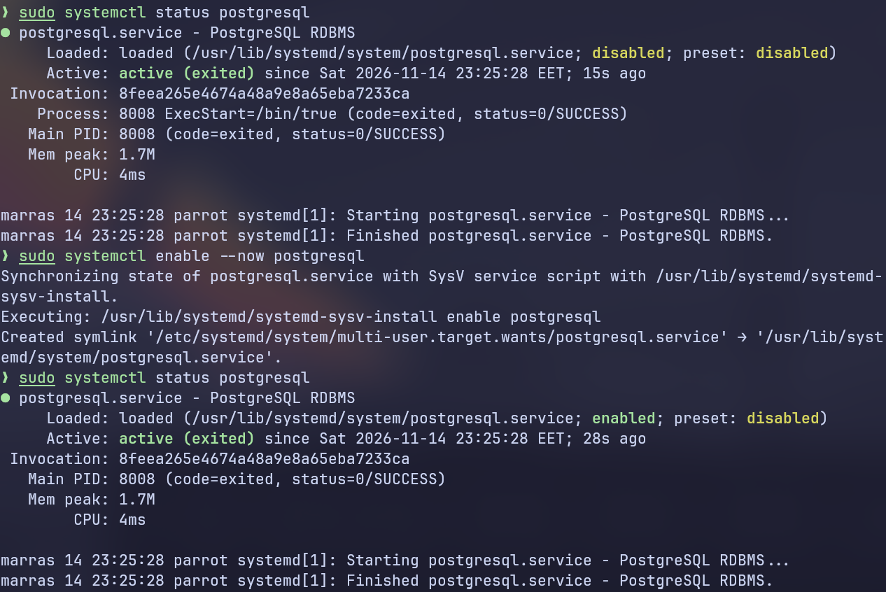

Loin postgres -käyttäjän sekä saman nimisen tietokannan.

	sudo -u postgres createuser miseno
	sudo -u postgres createdb miseno
- `sudo -u postgres` Komennot ajetaan postgres-käyttäjänä (postgresin pääkäyttäjä).

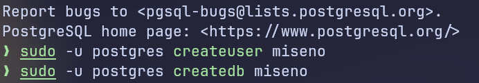

Kun yritin luoda taulun tietokantaan, tuli sama virheilmoitus kuin Terolle torstain luennolla. Postgres herjaa, että käyttäjälläni ei ole oikeuksia luoda tauluja public-skeemaan.

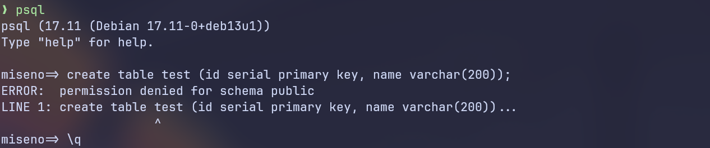

Halusin koittaa antaa oikeudet käyttäjälleni siinä kohdassa kun tietokanta luodaan. Muistelin, että siinä käytettiin -O flagia, mutta en muistanut tarkkaa syntaksia.
Selailin `psql --help` ja `man psql`, mutta etsin väärästä paikasta. Löysin lopulta oikean komennon createdb:n ohjeista.

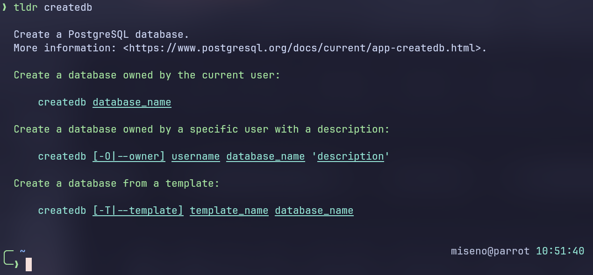

Pysäytin demonin ja poistin koneelta kaiken postgresiin liittyvän ja asensin sen uudestaan.

	sudo systemctl disable --now postgresql
	sudo apt-get purge 'postgresql*'
	sudo apt-get install -y postgresql
	sudo systemctl enable --now postgresql

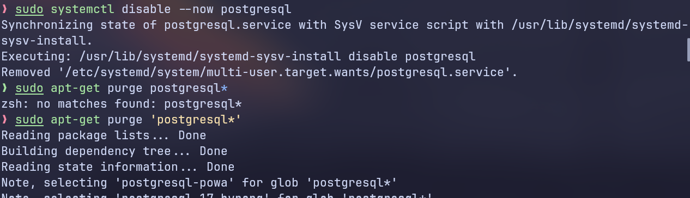

Tämän jälkeen loin käyttäjän uudestaan sekä tietokannan, mutta nyt määrittelin sille omistajan

	sudo -u postgres createuser miseno
	sudo -u postgres createdb -O miseno miseno

- `-O miseno` owner <käyttäjänimi>

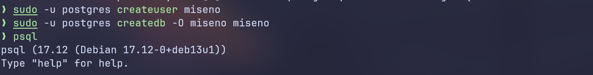

Sitten oli jälkellä enää testaus. Loin taulun tietokantaan ja määrittelin sille id:n lisäksi yhden nimi -arvon.


Sitten lisäsin tietokantaan yhden tietueen.

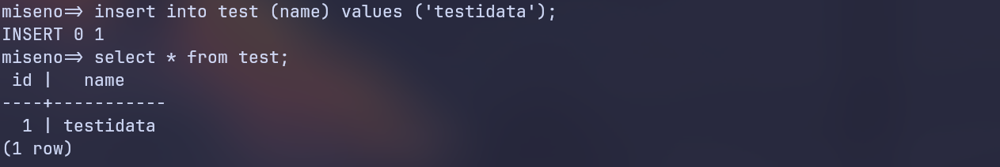

## b) Automaatti. Automatisoi valitsemasi demonin asennus Ansiblella.

Edellisen tehtävän tein omalla koneellani pyörivällä virtuaalikoneella. Tämän tehtävän tein virtuaalipalvelimelleni, joten purgea ei tarvinnut ajaa ennen playbookin ajamista. Kävin kuitenkin tarkistamassa että postgresql ei varmasti ole valmiiksi asennettuna palvelimellani.

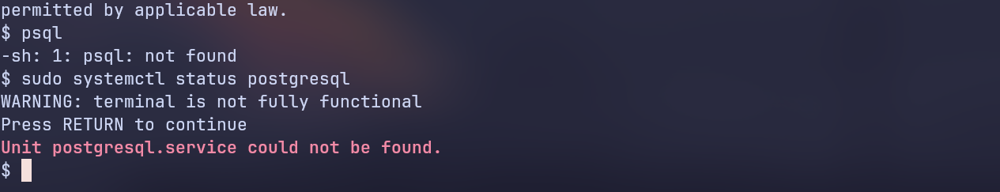

Sitten loin hakemistorakenteen valmiiksi postgres -roolille. Lisäsin roolin myös valmiiksi sites.yml -tiedostoon.

	mkdir -p roles/postgres/tasks
	mkdir -p roles/postgres/handlers

Tässä siis lähtötilanne.

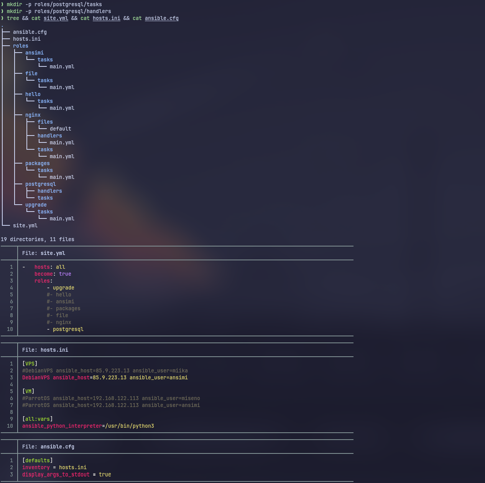

Tein main -tiedoston postgres -rooliin ja lisäsin sinne pakettikirjaston päivityksen ja postgresin asentamisen.

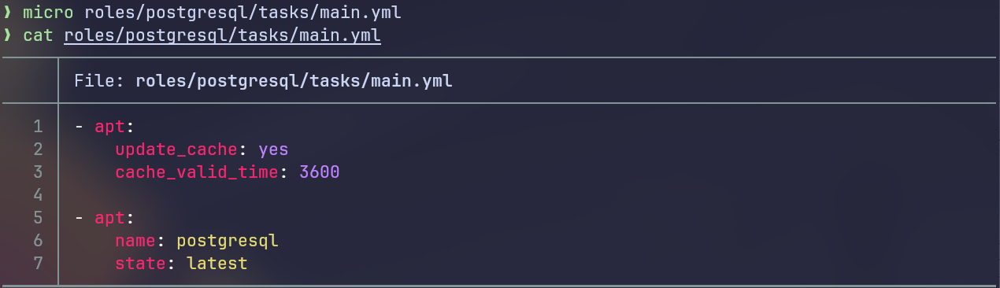

Playbook ajettiin onnistuneesti.

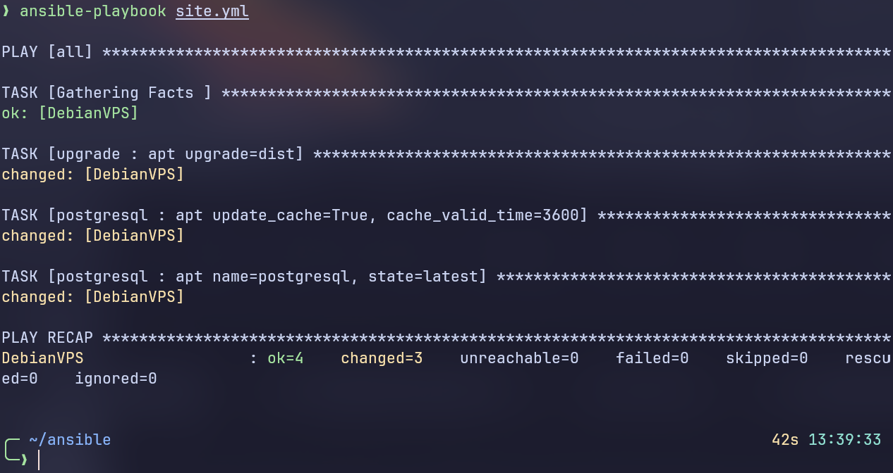

Seuraavaksi tein service -moduulin, jolla käynnistetään postgres.

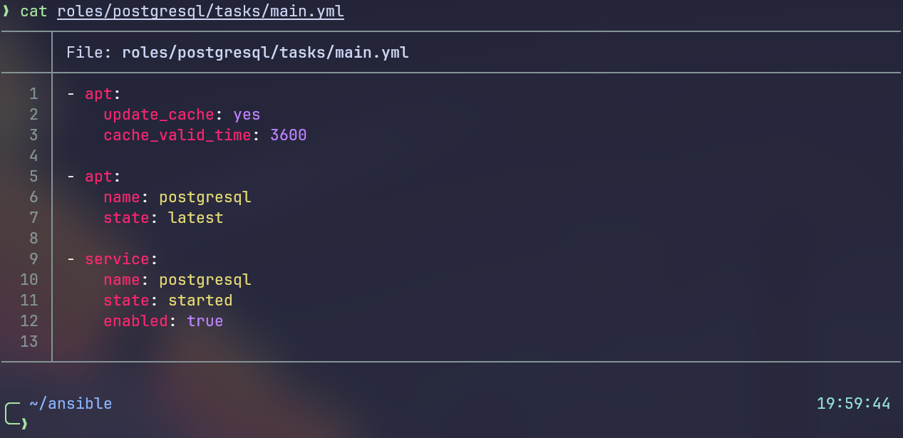

Ilmeisesti postgres käynnistyy automaattisesti, kun sen asentaa ansiblella, sillä tila ei muuttunut kun ajoin playbookin.

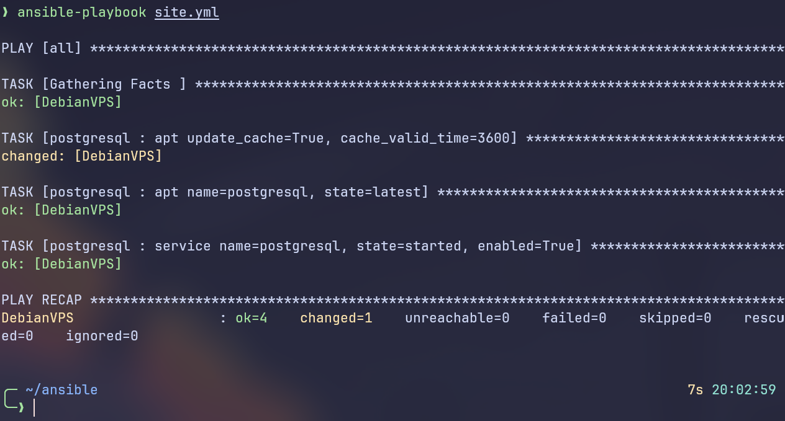

Oman mielenrauhan takaamiseksi kävin kuitenkin tarkistamassa, että demoni on tosiaan käynnissä orjakoneella.

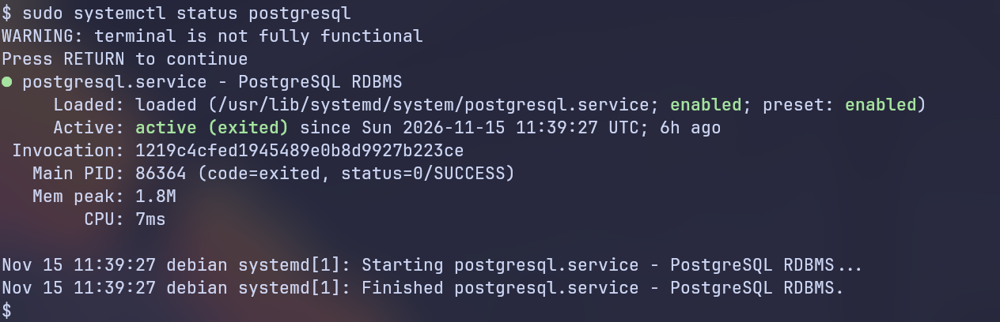

Seuraavaksi tässä tarvittiin become_user -avainsanaa, jota Tero esitteli torstain luennolla.

Ansiblen dokumentaation (ansible-doc) mukaan tätä käytetään oikeuksien korottamiseen. Tässä tapauksessa muutos tehdään postgres -käyttäjänä (sama kuin `sudo -u postgres`)

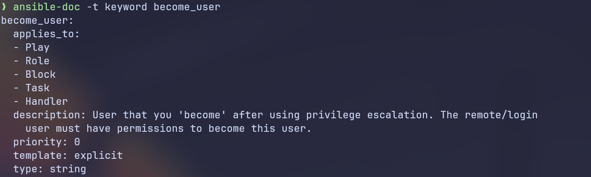

Tehdään siis moduulit, joilla luodaan uusi postgres-käyttäjä, sekä tietokanta jonka omistajaksi asetetaan uusi käyttäjämme. Tämä on kopioitu Teron luennolla esittelemästä ratkaisusta.

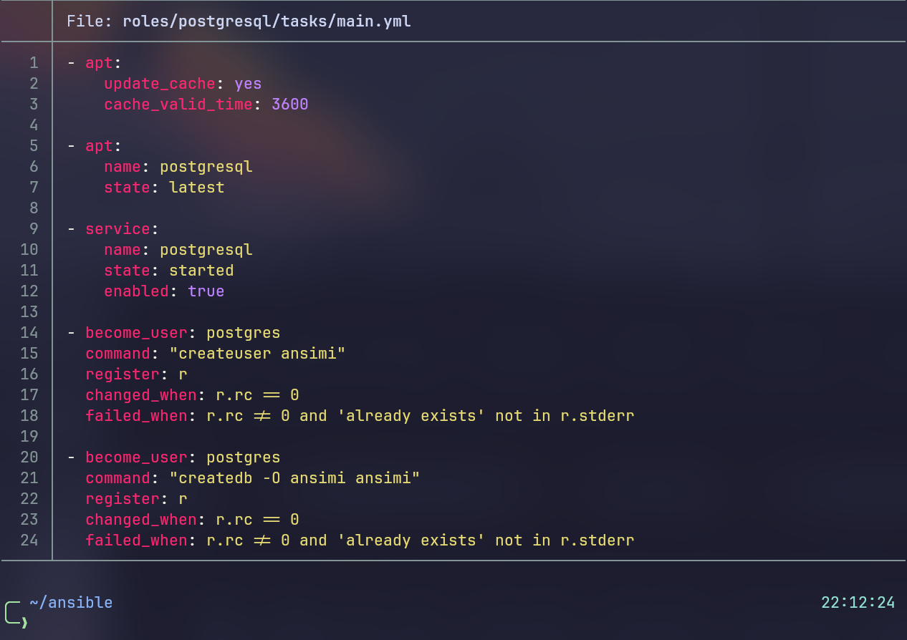

Pyysin tekoälyä (OpenAI) avaamaan toiminnon muita muuttujia.

`register` tallentaa suorituksen tulosteen. Tuloste voi sisältää esimerkiksi:
```
r:
  changed: true
  rc: 0
  stdout: ""
  stderr: ""
```
- `rc` komennon paluukoodi
- `stdout` komennon normaali tuloste
- `stderr` virhetuloste

Eli `changed_when` on tosi, kun paluukoodi on 0. Paluukoodi on tyypillisesti 0 sen onnistuessa.

Sen sijaan failed_when on tosi, jos paluukoodi on jotain muuta kuin 0 JA already exists ei ole virherulosteessa. Molempien ehtojen on siis täytyttävä samanaikaisesti.

Ehtolauseella ei siis valvota sitä, onko käyttäjä jo olemassa. Jos käyttäjä on olemassa, ansible suoritetaan loppuun ja se tulostaa ok. Sen sijaan jos esimerkiksi PostgreSQL ei ole käynnissä tai käyttäjällä ei ole oikeuksia luoda uutta käyttäjää, molemmat ehdot täyttyvät ja suoritus pysäytetään.

Playbookin ajaminen aiheutti errorin.

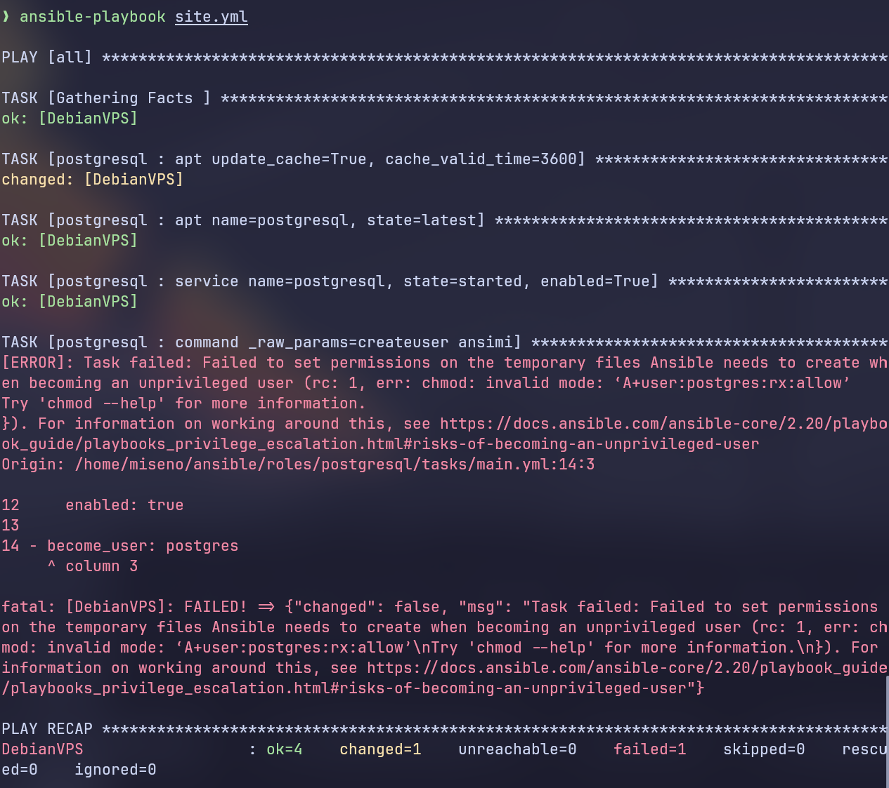

Error-tuloste kertoi, että Ansible luo tilapäisen tiedoston jota se tarvitsee kun se siirtyy käyttämään käyttäjää jolla ei ole sudo-oikeuksia. Tulosteessa näkyy myös, että tiedoston käyttäjäksi tulee postgres ja se koittaa antaa luku ja suoritusoikeudet postgresille. Eli ilmeisesti postgres ei ole ansiblen silmissä pääkäyttäjä?  
Tämä ei selventänyt minulle hirveästi mitään. Tuloste kehotti myös lukemaan ansiblen dokumentaatiota. Sieltä löysin kohdan jossa luki:
```
First, if setfacl is installed and available in the remote PATH,
and the temporary directory on the remote host is mounted with POSIX.1e
filesystem ACL support, Ansible will use POSIX ACLs to share the module
file with the second unprivileged user. (Ansible Core Documentation)
```	
	
Mikä helvetin ACL support? Googlettaminen tarjosi vain fysioterapeuttien tekemiä polven teippausvideoita.  
POSIX ACL:n hakeminen paljasti, että kyse on Access Control Lististä.
```
POSIX Access Control Lists (ACLs) are a security extension to the traditional
Unix permission model that allows for fine-grained access rights for files
and directories beyond the standard owner, group, and other categories. 
They enable administrators to assign specific read, write, or execute permissions
to multiple individual users or groups on a single file, providing greater
flexibility than standard POSIX permissions. (BraveAI, 1)
```
Googletin Install POSIX ACL ja kävi ilmi, että tämä on paketti joka on systemd:n riippuvuus ja pitäisi olla normaalisti esiasennettuna uudella koneella. Jostain syystä sitä ei ollut virtuaalipalvelimellani. (BraveAI, 2)

Lisäsin siis apt-moduuliin toisen asennettavan paketin, ACL:n.

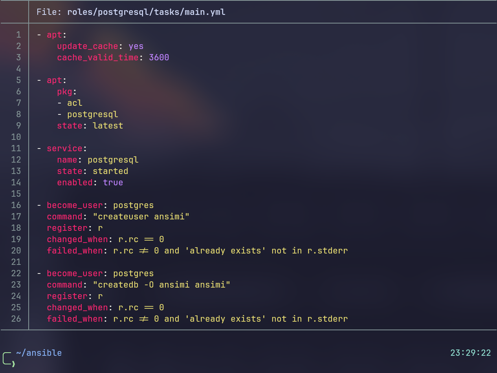

Tällä kertaa playbook meni läpi.

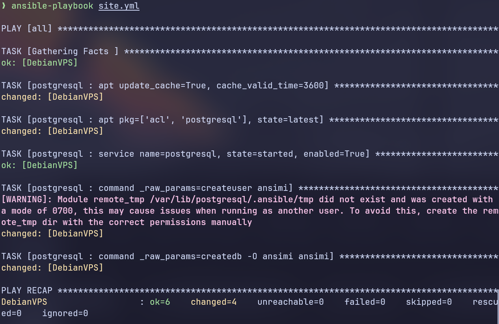

Ansible kuitenkin varoittaa, että sen luoma kansio tmp-tiedostoille luotiin 0700 -oikeuksilla ja että nämä kannattaisi käydä vaihtamassa, jos niihin pitää päästä käsiksi toisen käyttäjän toimesta.

Testataan vielä, että voimme manuaalisesti luoda taulun ja jotain tietoa tietokantaan.

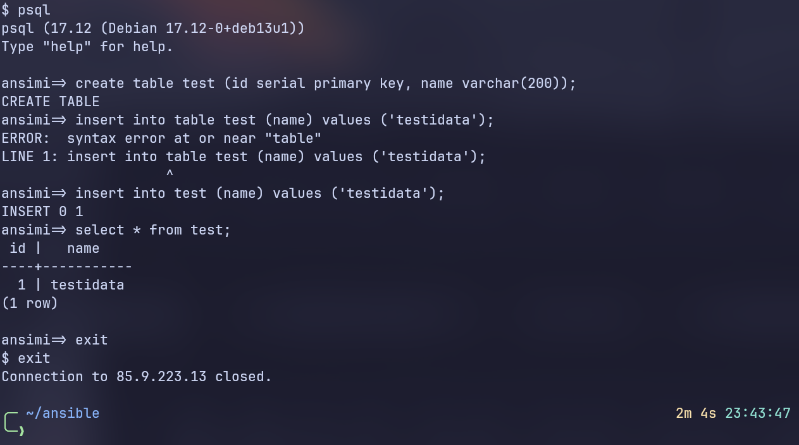
## c) Asetus. Muuta asetustiedostoa herralla (master, "control node") ja aja ansible uudestaan. Osoita, että asetukset tulivat käyttöön.
## d) Paikka remonttiin. Riko jotain asetuksia. Voit esimerkiksi poistaa demonin 'sudo apt-get purge foobar' (purge poistaa myös asetustiedostoja), poistaa asennuksen yhteydessä tulevan kansion (sudo rm -r /etc/foobar/ # vaarallista) tms. Ja sitten ajaa ansible-roolisi uudestaan ja todeta, että se korjaa tilanteen.
## e) Idempotentti. Osoita, että tilasi on idempotentti.
## Lähteet
Ansible-doc. `ansible-doc -t keyword become_user`. Ansiblen sisäänrakennettu ohje linuxin terminaalissa.

Ansible Core Documentation. Risks of becoming an unprivileged user. Luettavissa: https://docs.ansible.com/projects/ansible-core/2.20/playbook_guide/playbooks_privilege_escalation.html#risks-of-becoming-an-unprivileged-user Luettu: 15.11.2026.

BraveAI, 1. Brave -selaimen tekoälytiivistelmä. Haku: POSIX ACL

BraveAI, 1. Brave -selaimen tekoälytiivistelmä. Haku: Install POSIX ACL

OpenAI. 2026. ChatGPT (GPT-6). Tekoälyavusteinen keskustelu Ansiblen avainsanoista register, changed_when ja failed_when. 15.11.2026.

Karvinen, T . 2026. Palvelinten Hallinta. Luettavissa: https://terokarvinen.com/palvelinten-hallinta/ Luettu: 14.11.2026.

Karvinen, T . 2024. Väitöskirja. University of Westminster. https://westminsterresearch.westminster.ac.uk/item/w7vvz/configuration-management-of-distributed-systems-over-unreliable-and-hostile-networks Luettu: 14.11.2026.
