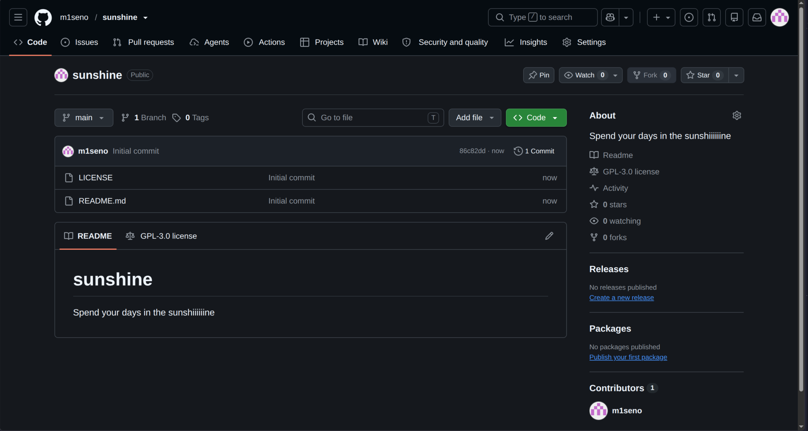
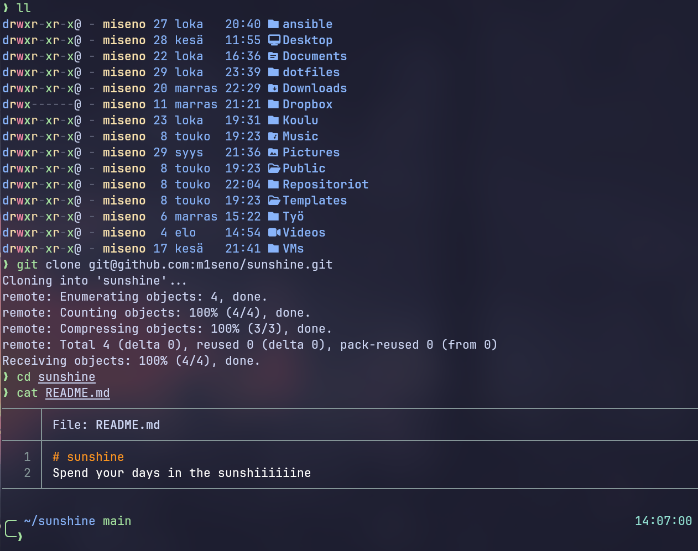

# Gitar Hero
Harjoitukset on tehty kotitoimistossa Kaarinassa. Koneena oli Tuxedo InfinityBook Pro AMD Gen10. Koneen käyttöjärjestlmänä toimii Fedora Linux 44. Virtuaalikoneen käyttöjärjestelmä on Parrot Security 7.4 (echo) x86_64. Virtuaalipalvelimen käyttis sen sijaan Debian 13.
Harjoituksessa seurataan Teron kotisivujen (Karvinen 2026) tehtävänantoa.
## x) Lue ja tiivistä. (Tässä x-alakohdassa ei tarvitse tehdä testejä tietokoneella, vain lukeminen tai kuunteleminen ja tiivistelmä riittää. Tiivistämiseen riittää muutama ranskalainen viiva. Kannattaa lisätä mukaan myös jokin oma havainto, idea tai kysymys.)
#### Chacon and Straub 2014: Pro Git, 2ed: 1.3 Getting Started - What is Git?
#### Gitin käyttö on lähinnä 'git add --all && git commit; git pull && git push'. Selitä tuon komennon jokainen osa. Käytä apuna itse valitsemiasi lähteitä ja viittaa niihin.
## a) Online. Tee uusi varasto GitHubiin (tai Gitlabiin tai mihin vain vastaavaan palveluun). Varaston nimessä ja lyhyessä kuvauksessa tulee olla sana "sunshine". Aiemmin tehty varasto ei kelpaa. (Muista tehdä varastoon tiedostoja luomisvaiheessa, esim README.md ja GNU General Public License 3) Edistyneemmille voi olla hauskaa etsiä ja kokeilla jokin muu palvelu kuin Github.
Tein uuden repositorion githubiin. Luontivaiheessa vahvistin, että haluan luoda README.md -tiedoston, jonne kuvaukseen kirjoittamani teksti menee. Lisäksi valitsin lisenssiksi Teron suositteleman GNU3:n.

## b) Dolly. Kloonaa edellisessä kohdassa tehty uusi varasto itsellesi, tee muutoksia omalla koneella, puske ne palvelimelle, ja näytä, että ne ilmestyvät weppiliittymään.
Kopioin githubista ssh-osoitteen ja kloonasin sen avulla etärepon omalle koneelleni.

	git clone git@github.com:m1seno/sunshine.git

## c) Doh! Tee tyhmä muutos gittiin, älä tee commit:tia. Tuhoa huonot muutokset ‘git reset --hard’. Huomaa, että tässä toiminnossa ei ole peruutusnappia.
Muokkasin README -tiedostoa.

	git status

Kertoo missä tiedostossa on tapahtunut muutos.

	git add .

Lisää kaikki muokatut tiedostot odottamaan committia.

	git reset --hard

Poistaa kaikki tehdyt muutokset ja palauttaa repon edellisen commitin tilaan.
## d) Tukki. Tarkastele ja selitä varastosi lokia. Näytä myös, mitä muutoksia tiedostoihin on tehty. Tarkista, että nimesi ja sähköpostiosoitteesi näkyy haluamallasi tavalla ja korjaa tarvittaessa.
## e) Gitanbile. Laita Ansible-kansio versionhallintaan. Tee jokin muutos, aja ansiblella, tallenna versio (commit).
## f) Hae pari projektiin Moodlen keskustelusta. (Tästä alakohdasta f ei tarvitse tehdä vaiheittaista teknistä raporttia, riittää kun toteat, että pari on hankittu. Pasilan ryhmä haki parin jo edellisessä tehtävässä, joten tämä on online-ryhmälle -3017.)
