# Gitar Hero
Harjoitukset on tehty kotitoimistossa Kaarinassa. Koneena oli Tuxedo InfinityBook Pro AMD Gen10. Koneen käyttöjärjestlmänä toimii Fedora Linux 44. Virtuaalikoneen käyttöjärjestelmä on Parrot Security 7.4 (echo) x86_64. Virtuaalipalvelimen käyttis sen sijaan Debian 13.
Harjoituksessa seurataan Teron kotisivujen (Karvinen 2026) tehtävänantoa.
## x) Lue ja tiivistä. (Tässä x-alakohdassa ei tarvitse tehdä testejä tietokoneella, vain lukeminen tai kuunteleminen ja tiivistelmä riittää. Tiivistämiseen riittää muutama ranskalainen viiva. Kannattaa lisätä mukaan myös jokin oma havainto, idea tai kysymys.)
#### Chacon and Straub 2014: Pro Git, 2ed: 1.3 Getting Started - What is Git?
- Git tallentaa projektin tilan snapshotseina, ei pelkästään tiedostojen muutoksina.
- Git toimii pääosin paikallisesti. Koko projektin versionhallinta on käyttäjän omalla koneella.
- Git käyttää hajautusarvoja (SHA-1 tai SHA-256) tiedostojen eheyden varmistamiseksi.
- Git ei poista tietoa, vaan kirjoittaa sitä. Tämä mahdollistaa vanhempien snapshottien palauttamisen tarvittaessa.
- Gitin kolme tilaa ovat Modified (muokattu), Staged (lisätty seuraavaan commitiin) ja Committed (tallennettu paikalliseen Git-tietokantaan).

#### Gitin käyttö on lähinnä 'git add --all && git commit; git pull && git push'. Selitä tuon komennon jokainen osa. Käytä apuna itse valitsemiasi lähteitä ja viittaa niihin.
- `git add --all` Lisää kaikki muokatut tiedostot staged -tilaan. Itse tykkään käyttää `git add .` joka tekee käytännössä saman asian.
- `git commit` Tallentaa muutokset repositorioon.
- `git pull` Hae muutokset etäreposta tai toisesta paikallisesta haarasta ja integroi ne nykyiseen paikalliseen haaraan. (Tämä saattaa tarvita `git merge`, jos olet jo ehtinyt tehdä muutoksia ennen pullia.)
- `git push` Työnnä commitit etärepoon.

Tietolähteenä toimi (git -h), sekä (Chacon and Straub 2014).

## a) Online. Tee uusi varasto GitHubiin (tai Gitlabiin tai mihin vain vastaavaan palveluun). Varaston nimessä ja lyhyessä kuvauksessa tulee olla sana "sunshine". Aiemmin tehty varasto ei kelpaa. (Muista tehdä varastoon tiedostoja luomisvaiheessa, esim README.md ja GNU General Public License 3) Edistyneemmille voi olla hauskaa etsiä ja kokeilla jokin muu palvelu kuin Github.
Tein uuden repositorion githubiin. Luontivaiheessa vahvistin, että haluan luoda README.md -tiedoston, jonne kuvaukseen kirjoittamani teksti menee. Lisäksi valitsin lisenssiksi Teron suositteleman GNU3:n.
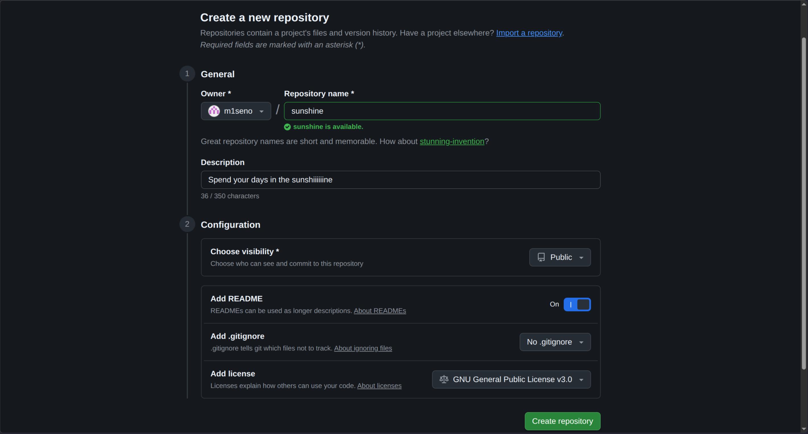

## b) Dolly. Kloonaa edellisessä kohdassa tehty uusi varasto itsellesi, tee muutoksia omalla koneella, puske ne palvelimelle, ja näytä, että ne ilmestyvät weppiliittymään.
Kopioin githubista ssh-osoitteen ja kloonasin sen avulla etärepon omalle koneelleni.

	git clone git@github.com:m1seno/sunshine.git

## c) Doh! Tee tyhmä muutos gittiin, älä tee commit:tia. Tuhoa huonot muutokset ‘git reset --hard’. Huomaa, että tässä toiminnossa ei ole peruutusnappia.
Muokkasin README -tiedostoa.

	git status

Kertoo missä tiedostossa on tapahtunut muutos.

	git add .

Lisää kaikki muokatut tiedostot odottamaan committia.

	git reset --hard

Poistaa kaikki tehdyt muutokset ja palauttaa repon edellisen commitin tilaan.
## d) Tukki. Tarkastele ja selitä varastosi lokia. Näytä myös, mitä muutoksia tiedostoihin on tehty. Tarkista, että nimesi ja sähköpostiosoitteesi näkyy haluamallasi tavalla ja korjaa tarvittaessa.
En ole käyttänyt `git log --patch` komentoa aikaisemmin. Kokeilin sitä toisessa repositoriossa, jossa oli kymmeniä committeja. Ilmeisesti se näyttää koko commit-historian sekä jokaisen commitin sisällön. 

Juuri tekemässäni repossa on pelkästään yksi commit, mutta sitä voi silti tarkastella.

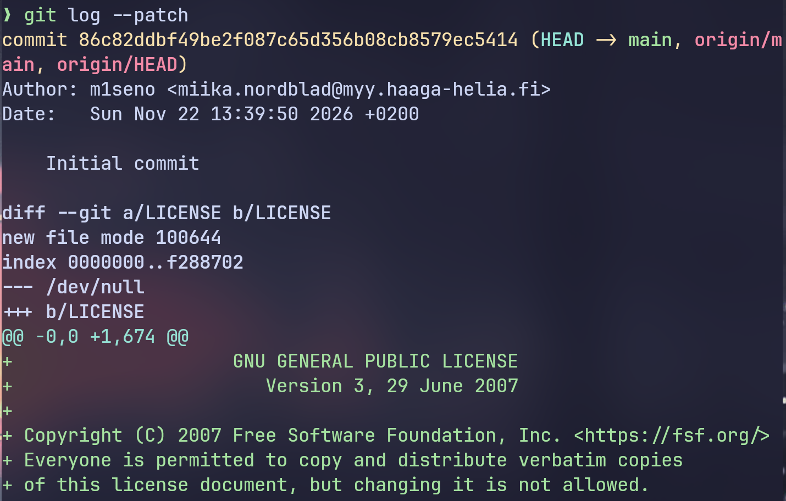

Ensimmäisenä näkyy commitin id. Tämän jälkeen kommitin kirjoittaja sekä päivämäärä.

Initial commit on commitin message. Tässä tapauksessa se on generoitu automaattisesti kun olen luonut repon.

Koska lisenssi on tekstitiedosto, myös sen sisältö näytetään kokonaan.

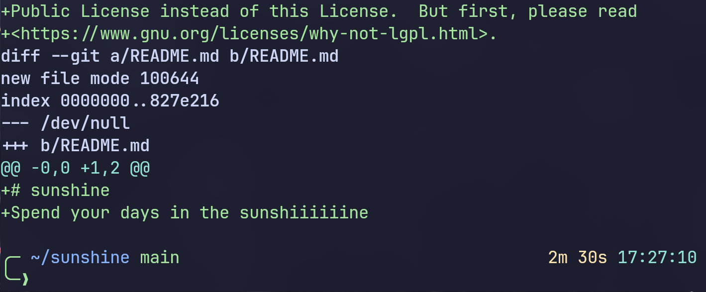

Toisessa kuvassa näkyy lisenssin loppu sekä seuraava tiedosto mikä luotiin, eli README.md. 

Vihreät + merkit tarkoittavat lisättyjä rivejä. Jos näkyisi punaisia miinuksia, ne olisivat poistettuja rivejä.
## e) Gitanbile. Laita Ansible-kansio versionhallintaan. Tee jokin muutos, aja ansiblella, tallenna versio (commit).
Tein ansible-kansiosta repositorion

	git init

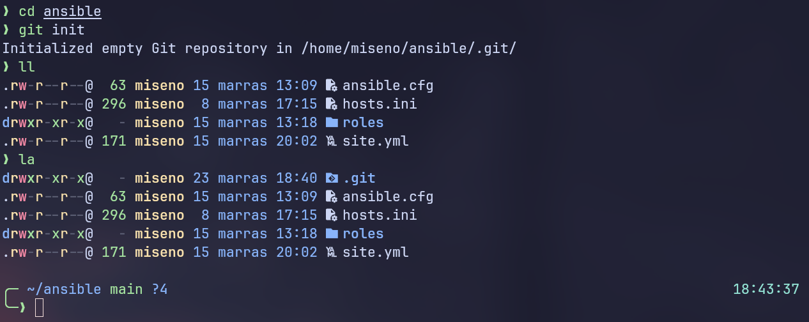

Seuraavaksi loin githubiin uuden etärepositorion.

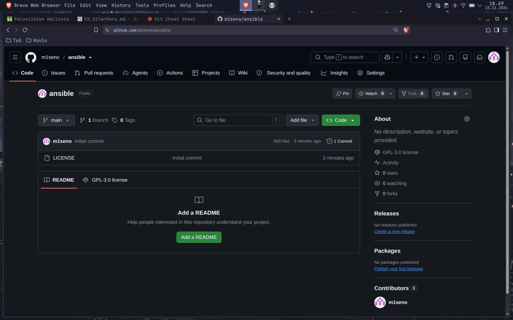

Tämä tulee aiheuttamaan ongelman, mihin olen monesti ennenkin törmannyt, sillä etärepon luominen tekee automaattisesti initial commitin. Tämä aiheuttaa ristiriidan etärepon ja paikallisen repon välillä. Mutta olen aina onnistunut tämän korjaamaan tekoälyn avustuksella, joten enköhän pysty siihen nyttenkin.

Tässä kohtaa piti luntata netistä ohjeita. Gitin sivuilta löytyy hyvä cheat sheet mistä näkee yleisimmin tarvittavat komennot (git-scm.com).

Seuraavaksi annoin seuraavat komennot:

	git remote add <name> <url>
	git remote -v

Ensimmäinen komento lisää etärepon osoitteen paikalliseen repositorioon.
Toinen komento tarkistaa, että lisäys onnistui.

Koitin myös lisätä lisenssin paikalliseen repooni komennolla:

	git fetch origin main

Mutta tämä ei toiminut, joten sitä ei kannata kokeilla.

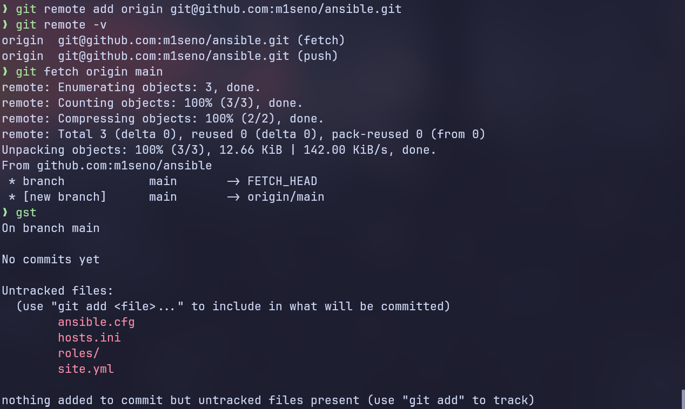

Seuraavaksi sitten peruskomennot muutoksien lisäykseen.

	git status
	git add .
	git commit -m "Kommentti"
	git push

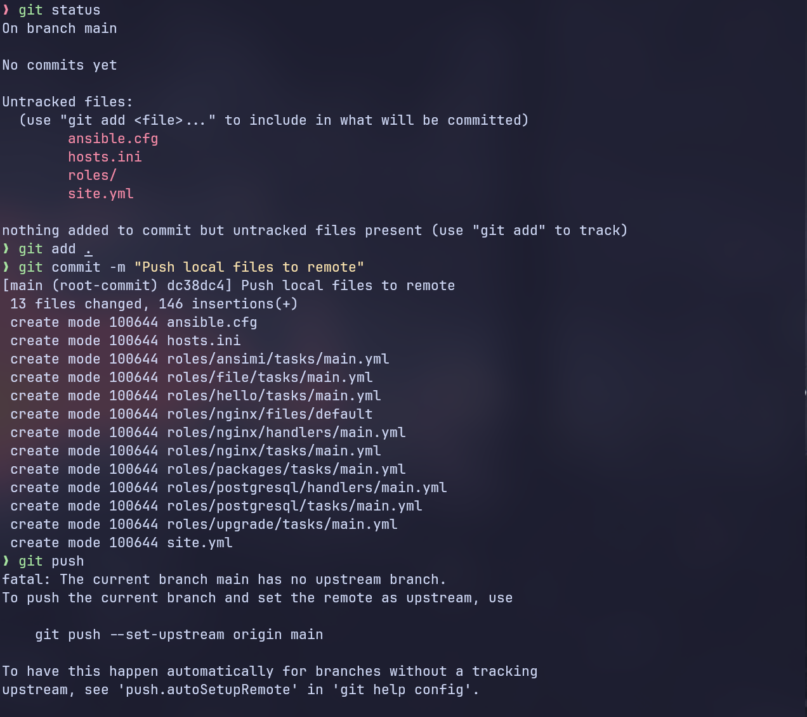

Git herjaa, että main-haara ei seuraa mitään vastinparia etärepossa, ja suositteleekin, että annetaan parametri `--set-upstream origin main`, jolla määritellään, että aina jatkossa paikallisen main-haaran muutokset pusketaan etärepon main-haaraan, jolloin jatkossa pelkkä `git push` riittää.

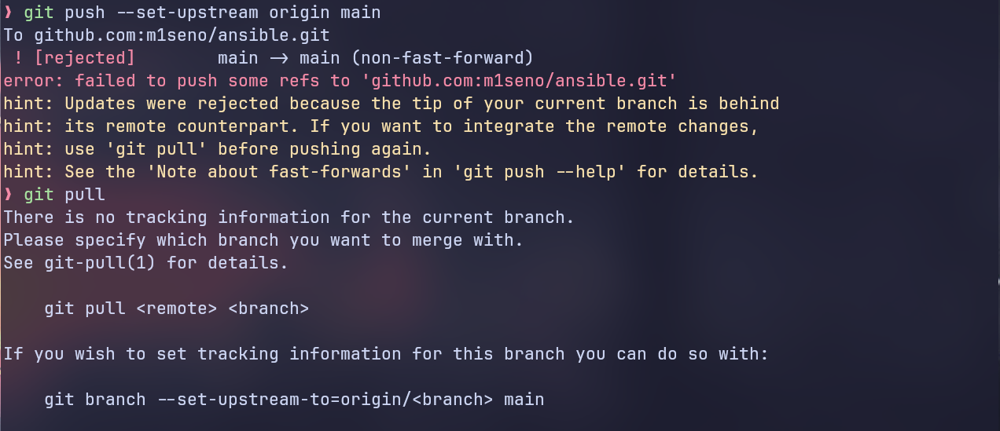

Tässä tultiin nyt siihen ongelmaan, minkä mainitsin aikaisemmin. Git suositteli ajamaan git pull, mutta kun tämäkin epäonnistui, niin pyysin tekoälyltä apua (OpenAI).

Tekoäly suositteli komentoa:

	git pull --no-rebase origin main --allow-unrelated-histories
	
- `--no-rebase` Halutaan käyttää mergeä, ei rebasea, haarojen yhdistämiseen.
- `--allow-unrelated-histories` Sallii kahden Git-historian yhdistämisen, joilla ei ole yhteistä alkuperäistä committia.

En itse tiennyt mitä eroa on rebasella ja mergellä. Ohjelmointiprojekti -kurssilla neuvottiin käyttämään mergeä.

Samassa keskustelussa tekoäly kuitenkin tarjosi tähän hyvän selityksen (OpenAI).

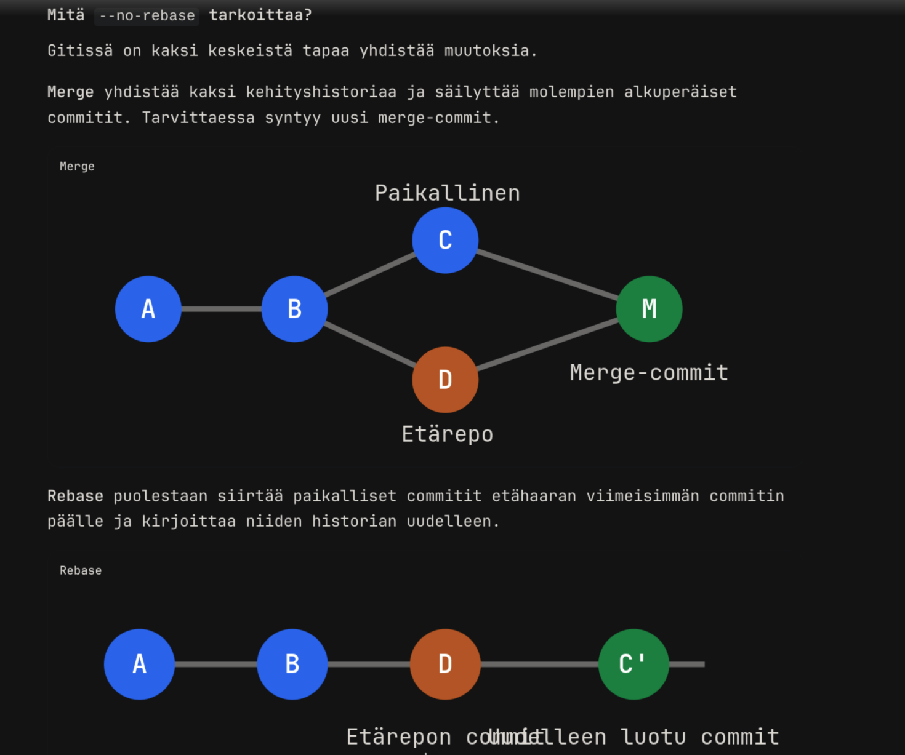

Ajoin kyseisen komennon onnistuneesti. Kuten ansible-kansion sisällöstä nähdään, niin Lisenssi on siirtynyt nyt myös paikalliseen repoon.

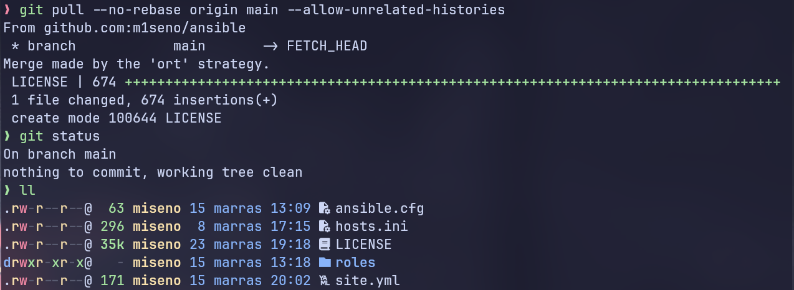

#### HUOM
Kun kyseisen komennon ajaa, avaa git automaattisesti tekstieditorin, johon voi muokata merge-commitin tietoja. Tämä ei kuitenkaan ole tarpeellista, joten tiedoston voi tallentaa ja editorin sulkea.

Sitten oli enää jäljellä paikallisten tiedostojen siirto etärepoon.

	git push -u origin main

- `-u` == `--set-upstream`

Kävin myös muodon vuoksi tarkistamassa, että kaikki kansion sisältö näkyy GitHubissa.

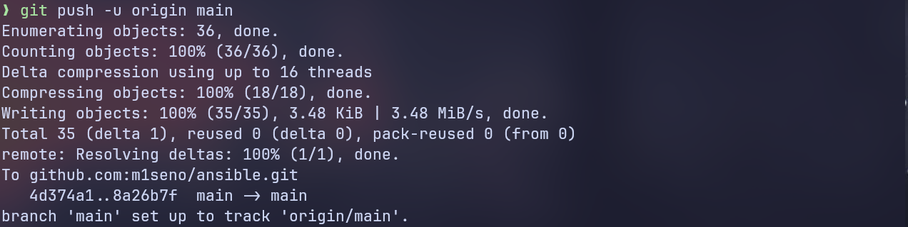
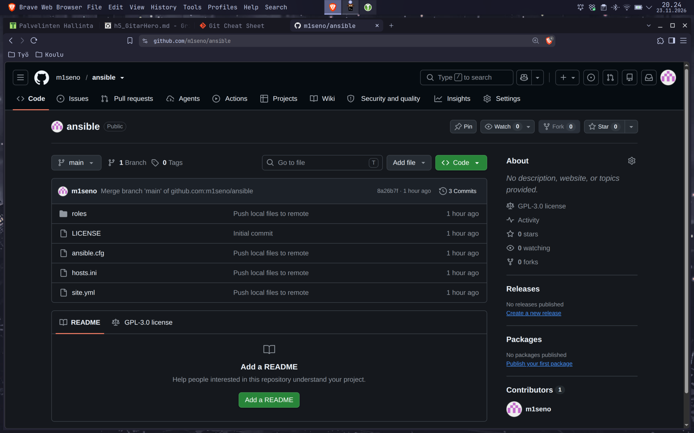

Lopuksi tein vielä muutoksen site.yml. Kommentoin kaikki muut roolit pois, paitsi upgraden, joka ajaa virtuaalipalvelimelleni dist-upgraden.

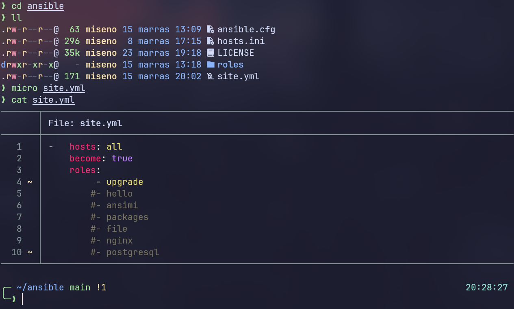

Playbook ajettiin onnistuneesti.

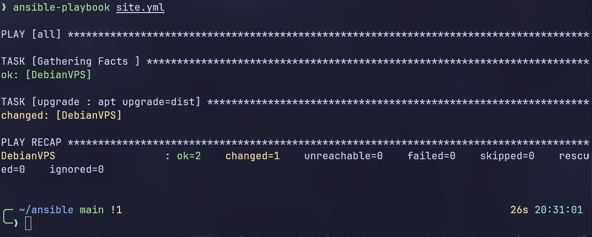

Sitten puskin vielä muutokset etärepoon.

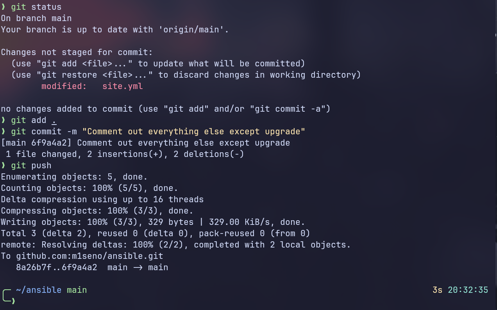

## f) Hae pari projektiin Moodlen keskustelusta. (Tästä alakohdasta f ei tarvitse tehdä vaiheittaista teknistä raporttia, riittää kun toteat, että pari on hankittu. Pasilan ryhmä haki parin jo edellisessä tehtävässä, joten tämä on online-ryhmälle -3017.)
Tero antoi luvan tehdä projektin yksilötyönä.

## Lähteet
Chacon and Straub. 2014. 1.3 Getting Started - What is Git?. Luettavissa: https://git-scm.com/book/en/v2/Getting-Started-What-is-Git%3F Luettu: 23.11.2026.

git -h. Gitin sisäänrakennettu help-työkalu linuxin terminaalissa. Luettu: 23.11.2026

git-scm.com. Git Cheat Sheet. Luettavissa: https://git-scm.com/cheat-sheet Luettu: 23.11.2026.

Karvinen, T . 2026. Palvelinten Hallinta. Luettavissa: https://terokarvinen.com/palvelinten-hallinta/ Luettu: 20.11.2026.

OpenAI. 2026. ChatGPT (GPT-6). Tekoälyavusteinen keskustelu paikallisen- ja etärepon ristiriidasta. 23.11.2026.
